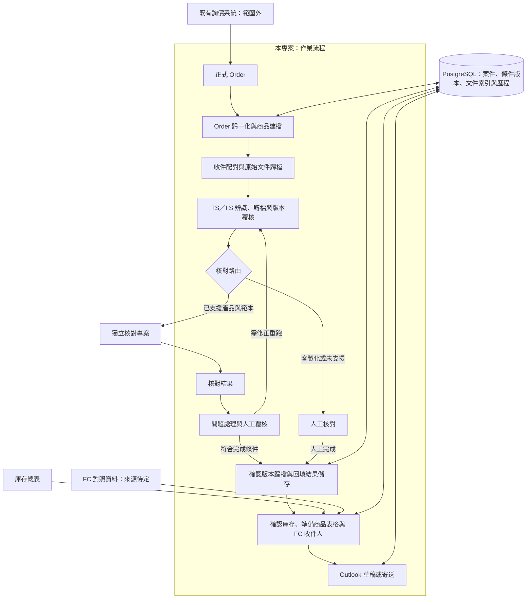

# 架構概觀／Architecture Overview

## 繁體中文

狀態：以下為規劃，並非已實作系統；已實作的只有「TS／IIS 準備」中的準備批次與放回資料夾（[#5](https://github.com/TaylorYam/structured-product-workflow/issues/5)，用法見 [README](../README.md)）。已確認需求見 [CONTEXT](../CONTEXT.md)。

### 模組與資料責任（建議）

本專案負責案件進度、Order 輸入、文件準備、歸檔、庫存讀取與寄送；核對專案負責文件解析及核對規則。正式 Order 經確認後提供參考條件表；庫存總表提供寄送資訊，兩者不互相默默覆蓋。

建議以內部案件編號支援尚未取得 TDCC 的階段，取得後再綁定。保存 Order 修訂、原始附件、轉檔輸出、人工決定與寄送紀錄。資料庫選用 PostgreSQL，詳見 [ADR 0001](adr/0001-postgresql-workflow-storage.md)；schema、多人併發實作及保存期限未定。

建議每階段獨立保存進度及重試；自動核對不通過不等於可直接寄送。人工核對須記錄人員、時間、結論及文件版本。原始與確認版本分開管理，附件使用已確認版本的指紋。

### 產品擴充（規劃）

Vanilla FCN 是目前優先範圍；EXPRESS FCN、BEN 是未來需求，尚未支援。產品類型、上手範本與樣態均需明確支援才走自動核對，未知或使用者指定時走人工。產品擴充的程式歸屬需另定，避免在流程專案複製核對規則。

### 執行環境與決策

公司 Windows、Outlook、Excel 與網路公槽是已知環境。先在本機開發 PostgreSQL，筆電與作業主機各有獨立資料庫，後續以公司伺服器支援協作為目標；公槽保存文件及備份。資料庫由本專案管理，checker 不直接存取。詳見 [資料庫與部署](database-and-deployment.md)。實際主機、權限、郵件接法及資料政策待確認。[串接提案](checker-integration.md) 為待驗證建議。[待定事項](open-questions.md) 必須在相關實作前處理。Word 轉 PDF 使用 Microsoft Word，見 [ADR 0002](adr/0002-word-to-pdf-with-microsoft-word.md)。

## English

Status: proposed architecture, not implemented, except batch preparation and return to folders within TS/IIS preparation ([#5](https://github.com/TaylorYam/structured-product-workflow/issues/5); usage in the [README](../README.md)). Confirmed requirements are in [CONTEXT](../CONTEXT.md).

The diagram above connects formal Orders, normalization/booking, incoming archiving, TS/IIS preparation, checking routes, approved archiving, inventory lookup, and Outlook distribution. Inquiry stays external. Automatic checking is an independent project; customized or unsupported cases route to manual review. Failed automatic checks return for remediation or explicit review rather than proceeding directly to distribution.

### Module and data ownership (recommended)

This repository owns case progress, Order ingestion, document preparation, archives, inventory lookup, and distribution. The checker owns parsing and checking rules. Confirmed formal Orders supply the checking reference workbook; inventory supplies distribution information. Neither silently overwrites the other.

Use an internal case ID before TDCC is available, then bind it. Preserve Order revisions, original attachments, converted outputs, human decisions, and distribution records. PostgreSQL is selected; see [ADR 0001](adr/0001-postgresql-workflow-storage.md). Schema, concurrency implementation, and retention remain unresolved.

Persist progress and retry each stage independently. Manual checking records reviewer, time, conclusion, and document version. Separate incoming sources from approved versions; bind attachments to approved file hashes.

### Product expansion (planned)

Vanilla FCN is the priority. EXPRESS FCN and BEN are future needs, not supported capabilities. Automatic routing requires explicit support for product, issuer template, and variant; unknown or operator-selected cases use manual checking. Decide future rule ownership separately and avoid duplicating checking rules here.

### Runtime and decisions

Known environment: company Windows, Outlook, Excel, and shared folders. Develop PostgreSQL locally with independent laptop/operational databases, targeting a company server for collaboration. Shared folders hold documents/backups. This project owns persistence; the checker does not access it. See [database and deployment](database-and-deployment.md). Actual host, access, mail integration, and policies remain unresolved. The [integration proposal](checker-integration.md) requires validation; resolve relevant [open questions](open-questions.md) before implementation. Word-to-PDF conversion uses Microsoft Word; see [ADR 0002](adr/0002-word-to-pdf-with-microsoft-word.md).
