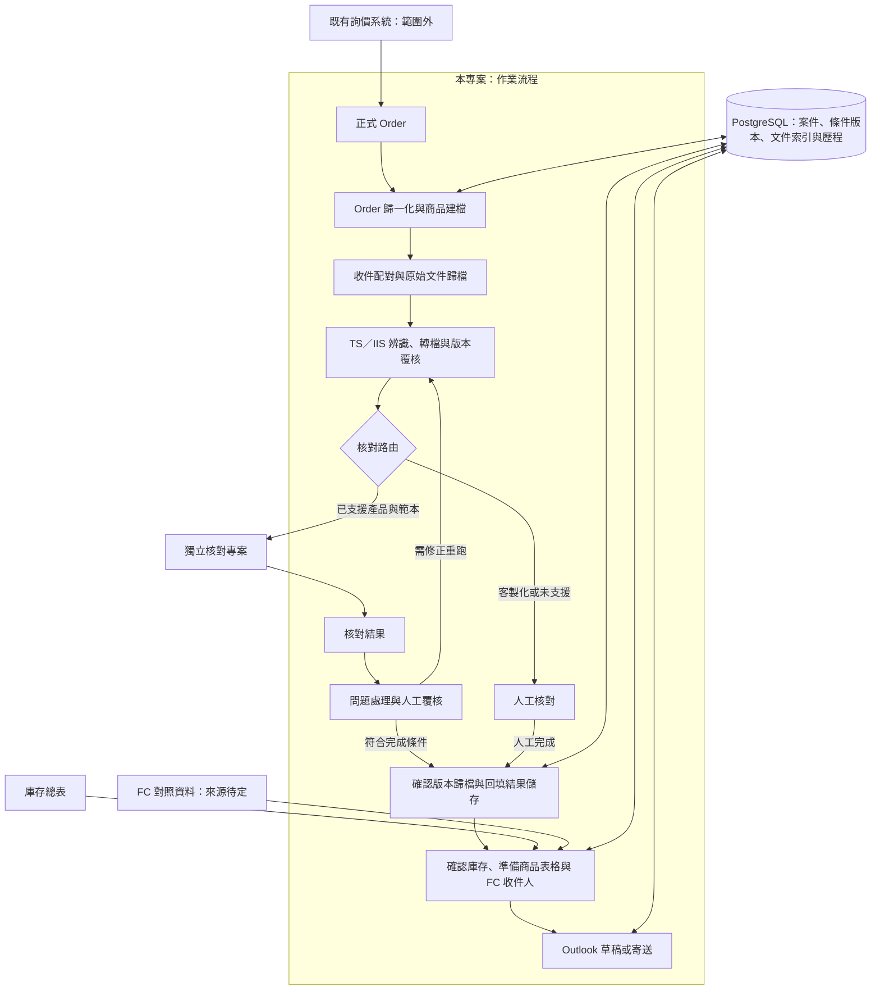

# 架構概觀／Architecture Overview

## 繁體中文

狀態：圖中「本專案：作業流程」已實作成一個 FCN Workflow 視窗（每日匯入、起單資料、準備、核對、放回、寄信草稿、人工維護、進度；用法見 [README](../README.md)）。圖裡的「獨立核對專案」已併入本 repo（`fcn_checker`，[ADR 0005](adr/0005-merge-checker-into-workflow.md)）；「庫存總表」與「FC 對照資料」改由資料庫裡的交易明細、商品條件與信箱表取代（[ADR 0004](adr/0004-mailbox-maintained-in-database.md)、[ADR 0006](adr/0006-new-product-data-from-order.md)）；「Outlook 草稿或寄送」目前只建草稿。已確認需求見 [CONTEXT](../CONTEXT.md)，尚未決定的見[待定事項](open-questions.md)。

### 模組與資料責任（建議）

本專案負責案件進度、Order 輸入、文件準備、歸檔、庫存讀取與寄送；核對專案負責文件解析及核對規則。正式 Order 經確認後提供參考條件表；庫存總表提供寄送資訊，兩者不互相默默覆蓋。

建議以內部案件編號支援尚未取得 TDCC 的階段，取得後再綁定。保存 Order 修訂、原始附件、轉檔輸出、人工決定與寄送紀錄。資料庫選用 PostgreSQL，詳見 [ADR 0001](adr/0001-postgresql-workflow-storage.md)；第一階段只存寄信與對帳需要的 FCN 資料，見 [ADR 0003](adr/0003-minimal-fcn-database.md)，信箱改由資料庫直接維護見 [ADR 0004](adr/0004-mailbox-maintained-in-database.md)；schema、多人併發實作及保存期限未定。

建議每階段獨立保存進度及重試；自動核對不通過不等於可直接寄送。人工核對須記錄人員、時間、結論及文件版本。原始與確認版本分開管理，附件使用已確認版本的指紋。

### 核對（`fcn_checker`）

核對程式與流程程式在同一個 repository、同一個套件（[ADR 0005](adr/0005-merge-checker-into-workflow.md)），但模組分開：`src/fcn_checker/` 負責 PDF 擷取、各上手範本解析、共用核對規則與回填，`src/sp_workflow/` 負責準備、放回、資料庫與寄信。兩者的資料目前只透過檔案銜接（標準檔名 PDF 與核對結果檔）；改成從資料庫讀條件、直接回填見 [ADR 0006](adr/0006-new-product-data-from-order.md)；新商品條件由「2 Order 條件」讀作業人員的起單建檔、確認後匯入（[ADR 0009](adr/0009-confirm-order-terms-in-window.md)、[ADR 0010](adr/0010-order-terms-from-daily-order-sheet.md)；期初定價日見 [ADR 0011](adr/0011-strike-date.md)）。商品條件寫入 `workflow.product` 只經過 `sp_workflow.product_write`（#124）：起單資料匯入、已鎖住更正（[ADR 0014](adr/0014-term-correction.md)）與人工維護（[ADR 0017](adr/0017-manual-maintenance-tab.md)、[ADR 0018](adr/0018-maintenance-trade-rows.md)）共用鎖列、確認打開後沒變、檢查、上手與面額、寫入、重算與紀錄的規則；核對寫回（`check_source.write_back`，[ADR 0013](adr/0013-check-from-database.md)）照舊比對核對時的參考條件表，只共用它的鎖。`workflow.product` 的欄、畫面的欄名與型別、必填欄（`REQUIRED`）和兩邊的轉換（KO／KI 代碼、UF = 100 − Upfront / NotePrice、單位面額預設）只在 `sp_workflow.product_record`（#126）：寫入、起單資料讀取、核對條件、核對讀資料庫與寄信草稿都從它拿；它不 import 這些 module，`REQUIRED` 放在這裡就不會循環 import（[ADR 0016](adr/0016-partial-product-terms.md) 當時搬到 `order_terms` 的原因）。畫面只有一個 FCN Workflow 視窗（[ADR 0007](adr/0007-single-workflow-window.md)）：外殼（頂端列、步驟欄、「維護」選單、關閉與啟動參數）在 `sp_workflow.app`，流程分頁一頁一個 module 在 `sp_workflow.tabs`（`daily`、`orders`、`prepare`、`returning`、`mail`、`manual`、`progress`，名稱同 `PanelWindow` 的屬性；分頁共用的版面 `Tab`、根目錄與資料庫登入在 `tabs.base`，2、7 頁右邊的編輯區在 `tabs.editor`，7 頁的檢查結果表在 `tabs.cell_table`，1、2 頁共用的核對條件重算顯示與「放行差異…」在 `tabs.recalc`，#138）；要連資料庫的按鈕各呼叫 `sp_workflow.window_actions` 的一個動作，連線、transaction 邊界與容錯（例如匯入成功、重算失敗時匯入保留，[ADR 0012](adr/0012-check-terms-calculation.md)）都在那裡，分頁只收輸入、在背景執行、顯示結果（#125）。「3 準備」「5 放回」「6 寄信草稿」也經過 `window_actions`：清單產出之後由 `sp_workflow.step_records` 為每檔寫一筆步驟紀錄 `workflow.step_record`（只新增、不修改；寫入失敗只寫在結果裡、不影響清單，#151、[ADR 0019](adr/0019-progress-step-records-and-lifecycle-events.md)）。存續狀態只看 `sp_workflow.lifecycle`：存續事件 `workflow.product_event` 只新增，自動事件（KO、接股、到期還本）只能由比價整組取代、差異記在 `workflow.product_event_change`，人工只能登記顧客贖回與提出異議（`workflow.event_objection`），資料庫的 trigger 擋下修改與刪除（#152、[ADR 0019](adr/0019-progress-step-records-and-lifecycle-events.md)）；`workflow.product.status_event` 等四欄不再讀寫。比價用的收盤價在 `sp_workflow.close_prices`：以實際收盤日＋去掉類別字的代碼存進 `workflow.close_price`，只存該代碼市場的交易日（用 `fcn_checker.trading_calendar` 的假日表判斷），來源是回補股價的 MarketData CSV（`daily_import.import_price_csv` 在同一個 transaction 裡寫）與維護選單一次匯入的歷史收盤價；以取價日為鍵的 `workflow.daily_price` 照舊只給核對條件用（#153、[ADR 0020](adr/0020-close-prices-and-observation-rules.md)）。作業進度只看 `sp_workflow.progress`：由交易明細、商品條件、核對條件、核對結果、鎖住時間與步驟紀錄依序推出每檔一個進度，不另外存；「8 進度」讀、篩選與匯出，也是登記已寄出、顧客贖回與提出、解除異議唯一的入口（經 `window_actions`，一檔一個 transaction，#156、#157、[ADR 0019](adr/0019-progress-step-records-and-lifecycle-events.md)）。比價只在 `sp_workflow.observation`：`observe` 只算一檔（逐日比 KO、KI、到期，缺價格停住），不碰資料庫；`observe_all` 讀核對條件「完成」的商品與收盤價、算全部，自動事件經 `lifecycle.replace_auto_events` 寫入，每檔的比價狀態 `workflow.pricing_status` 有變才寫；`window_actions` 在回補股價與歷史收盤價匯入之後呼叫它，失敗時匯入保留（#155、[ADR 0020](adr/0020-close-prices-and-observation-rules.md)）。舊商品補價格與比價日在 `sp_workflow.legacy_backfill`：讀參考條件表格式的 Excel，只補已鎖住、還缺 `underlying_price` 或 `autocall_date` 的商品，庫存狀態經 `lifecycle.record_legacy` 寫成舊清單事件，一個 transaction（#154）。`sp_workflow.app` 從 `fcn_checker.panel` 只 import 核對頁 `CheckTab`；整個視窗共用的配色與樣式、圖示、各頁共用的藍色提示條 `HintBar`、「下一步」按鈕 `NextButton`、頁首 `PageHeader`、重點數字 `KpiRow`（#83）、結果表的複製元件（右鍵選單 `CopyMenu`、Treeview 的右鍵與 Ctrl+A／Ctrl+C `TableCopy`、「全部複製」那一列 `CopyArea`，#121），以及全視窗唯一的背景作業寫法 `Background`（每個分頁一個，動作依序在背景執行緒做、做完回主執行緒）都在 `fcn_checker.ui`，核對頁與外殼都從那裡 import；啟動參數 `parse_args`、`session_from_args` 由外殼擁有（#129）。外殼先建資料庫登入與核對的資料庫來源（`check_source.WorkflowDatabase`），核對工作階段建好時就帶著它；資料庫來源只在背景拿外殼登入過的連線設定、不問密碼，核對頁要連資料庫前請外殼在主執行緒登入（#129）。步驟銜接時，外殼用 `CheckTab.receive_pdfs` 帶入準備好的 PDF、用 `on_saved` 得知核對存檔，選了哪些 PDF 與條件來源讀核對工作階段（#76）；反方向只有 `fcn-panel` 入口在函式裡呼叫 `sp_workflow.app` 開視窗。核對內部的資料流、模組邊界與決策見 [核對架構](checker/architecture.md) 與 [核對 ADR](checker/adr/README.md)（另一套編號）。

### 產品擴充（規劃）

Vanilla FCN 是目前優先範圍；EXPRESS FCN、BEN 是未來需求，尚未支援。產品類型、上手範本與樣態均需明確支援才走自動核對，未知或使用者指定時走人工。產品擴充的程式歸屬需另定，避免在流程專案複製核對規則。

### 執行環境與決策

公司 Windows、Outlook、Excel 與網路公槽是已知環境。先在本機開發 PostgreSQL，筆電與作業主機各有獨立資料庫，後續以公司伺服器支援協作為目標；公槽保存文件及備份。資料庫由本專案管理。核對專案已決定併入本專案（[ADR 0005](adr/0005-merge-checker-into-workflow.md)），新商品資料由 Order、交易明細與股價建立，核對直接讀寫資料庫（[ADR 0006](adr/0006-new-product-data-from-order.md)）；每日股價範本、單位面額與 Order 日期的規則見 [ADR 0008](adr/0008-daily-prices-denomination-and-order-dates.md)，Order 條件在視窗裡確認後匯入見 [ADR 0009](adr/0009-confirm-order-terms-in-window.md)，匯入後算出核對條件與放行差異見 [ADR 0012](adr/0012-check-terms-calculation.md)，核對從資料庫讀條件並寫回見 [ADR 0013](adr/0013-check-from-database.md)，鎖住後更正商品條件見 [ADR 0014](adr/0014-term-correction.md)，回補股價 CSV 見 [ADR 0015](adr/0015-price-csv-backfill.md)，商品條件可以部分空白、缺資料停在待確認見 [ADR 0016](adr/0016-partial-product-terms.md)，「7 人工維護」找出缺資料的商品、補齊與更正商品條件見 [ADR 0017](adr/0017-manual-maintenance-tab.md)，在人工維護修改交易明細見 [ADR 0018](adr/0018-maintenance-trade-rows.md)，作業進度、步驟紀錄與存續事件見 [ADR 0019](adr/0019-progress-step-records-and-lifecycle-events.md)，收盤價資料與比價規則見 [ADR 0020](adr/0020-close-prices-and-observation-rules.md)。詳見 [資料庫與部署](database-and-deployment.md)。實際主機、權限、郵件接法及資料政策待確認。[串接提案](checker-integration.md) 為待驗證建議。[待定事項](open-questions.md) 必須在相關實作前處理。Word 轉 PDF 使用 Microsoft Word，見 [ADR 0002](adr/0002-word-to-pdf-with-microsoft-word.md)。

## English

Status: the "this repository: workflow" part of the diagram is implemented as one FCN Workflow window (daily import, order sheet, preparation, checking, return, mail drafts, manual maintenance, progress; usage in the [README](../README.md)). The diagram's "independent checker project" has been merged into this repository (`fcn_checker`, [ADR 0005](adr/0005-merge-checker-into-workflow.md)); the "inventory master" and "FC mapping data" are replaced by the trade rows, product terms, and mailbox table in the database ([ADR 0004](adr/0004-mailbox-maintained-in-database.md), [ADR 0006](adr/0006-new-product-data-from-order.md)); "Outlook draft or send" currently only creates drafts. Confirmed requirements are in [CONTEXT](../CONTEXT.md); undecided items are in [open questions](open-questions.md).

The diagram above connects formal Orders, normalization/booking, incoming archiving, TS/IIS preparation, checking routes, approved archiving, inventory lookup, and Outlook distribution. Inquiry stays external. Automatic checking lives in `fcn_checker` inside this repository; customized or unsupported cases route to manual review. Failed automatic checks return for remediation or explicit review rather than proceeding directly to distribution.

### Module and data ownership (recommended)

This repository owns case progress, Order ingestion, document preparation, archives, inventory lookup, and distribution. The checker owns parsing and checking rules. Confirmed formal Orders supply the checking reference workbook; inventory supplies distribution information. Neither silently overwrites the other.

Use an internal case ID before TDCC is available, then bind it. Preserve Order revisions, original attachments, converted outputs, human decisions, and distribution records. PostgreSQL is selected; see [ADR 0001](adr/0001-postgresql-workflow-storage.md). The first phase stores only FCN data needed for mail and reconciliation; see [ADR 0003](adr/0003-minimal-fcn-database.md); the mailbox is maintained directly in the database per [ADR 0004](adr/0004-mailbox-maintained-in-database.md). Schema, concurrency implementation, and retention remain unresolved.

Persist progress and retry each stage independently. Manual checking records reviewer, time, conclusion, and document version. Separate incoming sources from approved versions; bind attachments to approved file hashes.

### Checking (`fcn_checker`)

The checker and the workflow share one repository and one package ([ADR 0005](adr/0005-merge-checker-into-workflow.md)) but stay separate modules: `src/fcn_checker/` owns PDF extraction, issuer template parsing, shared checking rules, and backfill; `src/sp_workflow/` owns preparation, returning, the database, and mail. Their data currently connects only through files (standard-name PDFs and the result workbook); reading terms from the database and backfilling directly is covered by [ADR 0006](adr/0006-new-product-data-from-order.md); new product terms come from the operators' daily order sheet, confirmed on "2 Order 條件" and imported ([ADR 0009](adr/0009-confirm-order-terms-in-window.md), [ADR 0010](adr/0010-order-terms-from-daily-order-sheet.md); the initial pricing date is in [ADR 0011](adr/0011-strike-date.md)). Product terms reach `workflow.product` only through `sp_workflow.product_write` (#124): the order-sheet import, locked-term corrections ([ADR 0014](adr/0014-term-correction.md)), and manual maintenance ([ADR 0017](adr/0017-manual-maintenance-tab.md), [ADR 0018](adr/0018-maintenance-trade-rows.md)) share its row locking, unchanged-since-opened check, validation, issuer and denomination rules, write, recalculation, and records; the check write-back (`check_source.write_back`, [ADR 0013](adr/0013-check-from-database.md)) still compares against the reference workbook used for checking and shares only its lock. The `workflow.product` columns, the on-screen field names and kinds, the required fields (`REQUIRED`), and the conversions between them (KO/KI codes, UF = 100 − Upfront / NotePrice, the default denomination) live only in `sp_workflow.product_record` (#126): the writer, the order-sheet reader, check terms, the database check source, and mail drafts all take them from there; it imports none of those modules, so keeping `REQUIRED` there avoids the circular import that moved it to `order_terms` in [ADR 0016](adr/0016-partial-product-terms.md). There is one FCN Workflow window ([ADR 0007](adr/0007-single-workflow-window.md)): the shell (top bar, step sidebar, the 維護 menu, closing, and the launch arguments) lives in `sp_workflow.app`, and the workflow tabs live one module each in `sp_workflow.tabs` (`daily`, `orders`, `prepare`, `returning`, `mail`, `manual`, `progress`, named after the `PanelWindow` attributes; the shared tab layout `Tab`, the root folder, and the database login are in `tabs.base`, the editor on the right of tabs 2 and 7 in `tabs.editor`, tab 7's check-result table in `tabs.cell_table`, and the check-term recalculation display with the 放行差異 button shared by tabs 1 and 2 in `tabs.recalc`, #138); each button that touches the database calls one action in `sp_workflow.window_actions`, which owns the connection, transaction boundaries, and failure handling (for example, an import that succeeded is kept when the recalculation after it fails, [ADR 0012](adr/0012-check-terms-calculation.md)), so the tabs only collect input, run the action in the background, and render the result (#125). "3 準備", "5 放回", and "6 寄信草稿" also go through `window_actions`: after the list is produced, `sp_workflow.step_records` writes one step record per product to `workflow.step_record` (insert-only; a failed write is reported in the result and never affects the list, #151, [ADR 0019](adr/0019-progress-step-records-and-lifecycle-events.md)). The lifecycle status comes only from `sp_workflow.lifecycle`: lifecycle events in `workflow.product_event` are insert-only, automatic events (KO, 接股, 到期還本) are replaced only as a set by observation with the difference recorded in `workflow.product_event_change`, people can only record 顧客贖回 and raise objections (`workflow.event_objection`), and database triggers block edits and deletes (#152, [ADR 0019](adr/0019-progress-step-records-and-lifecycle-events.md)); `workflow.product.status_event` and its three companion columns are no longer read or written. Close prices for observation live in `sp_workflow.close_prices`: `workflow.close_price` is keyed by the actual closing day and the code without its class word, and stores only trading days of the code's market (decided with the `fcn_checker.trading_calendar` holiday calendar); its sources are the MarketData CSV of the price backfill (`daily_import.import_price_csv` writes it in the same transaction) and the one-off historical close import on the maintenance menu, while the price-date `workflow.daily_price` still serves check terms only (#153, [ADR 0020](adr/0020-close-prices-and-observation-rules.md)). The workflow progress comes only from `sp_workflow.progress`, which derives one step per product in order from trade rows, product terms, check terms, check results, the lock time, and step records, and stores nothing; "8 進度" reads, filters, and exports it and is the only place to record 已寄出, customer redemptions, and to raise or resolve objections (through `window_actions`, one transaction per product, #156, #157, [ADR 0019](adr/0019-progress-step-records-and-lifecycle-events.md)). Observation lives only in `sp_workflow.observation`: `observe` handles one product (KO, KI, and maturity day by day, stopping at a missing price) without touching the database; `observe_all` reads the products whose check terms are 完成 and their closes, runs them all, writes automatic events through `lifecycle.replace_auto_events`, and writes each product's `workflow.pricing_status` only when it changes; `window_actions` calls it after the price backfill and the historical close import, keeping the import when it fails (#155, [ADR 0020](adr/0020-close-prices-and-observation-rules.md)). The old-product backfill lives in `sp_workflow.legacy_backfill`: it reads a reference-workbook-format Excel, fills only locked products still lacking `underlying_price` or `autocall_date`, and writes the 庫存狀態 as 舊清單 events through `lifecycle.record_legacy`, all in one transaction (#154). `sp_workflow.app` imports only the check tab `CheckTab` from `fcn_checker.panel`; the shared palette and style, icon, the shared blue hint bar `HintBar`, next-step button `NextButton`, page header `PageHeader`, key-figure row `KpiRow` (#83), the result-table copy widgets (the right-click menu `CopyMenu`, the Treeview right-click and Ctrl+A/Ctrl+C handler `TableCopy`, and the copy-all bar `CopyArea`, #121), and the window's single background-work helper `Background` (one per tab; actions run in order on a worker thread and report back on the main thread) live in `fcn_checker.ui`, which both the check tab and the shell import; the shell owns the launch arguments `parse_args` and `session_from_args` (#129). The shell builds the database login and the check's database source (`check_source.WorkflowDatabase`) first, and the check session receives that source when it is constructed; the source only reads the shell's logged-in connection settings in the background and never prompts, and the check tab asks the shell to log in on the main thread before it touches the database (#129). For step handoffs the shell passes prepared PDFs in with `CheckTab.receive_pdfs`, learns about saved checks through `on_saved`, and reads the chosen PDFs and terms source from the check session (#76); in the other direction, only the `fcn-panel` entry point calls `sp_workflow.app` from inside a function to open the window. The checker's internal data flow, module boundaries, and decisions are in the [checker architecture](checker/architecture.md) and the [checker ADRs](checker/adr/README.md) (a separate numbering).

### Product expansion (planned)

Vanilla FCN is the priority. EXPRESS FCN and BEN are future needs, not supported capabilities. Automatic routing requires explicit support for product, issuer template, and variant; unknown or operator-selected cases use manual checking. Decide future rule ownership separately and avoid duplicating checking rules here.

### Runtime and decisions

Known environment: company Windows, Outlook, Excel, and shared folders. Develop PostgreSQL locally with independent laptop/operational databases, targeting a company server for collaboration. Shared folders hold documents/backups. This project owns persistence. The checker will be merged into this repository ([ADR 0005](adr/0005-merge-checker-into-workflow.md)); new product data is built from Orders, trade rows, and prices, and checking reads and writes the database directly ([ADR 0006](adr/0006-new-product-data-from-order.md)); the daily price template, denomination, and Order date rules are in [ADR 0008](adr/0008-daily-prices-denomination-and-order-dates.md), in-window confirmation of Order terms before import is in [ADR 0009](adr/0009-confirm-order-terms-in-window.md), calculating check terms and releasing differences after imports is in [ADR 0012](adr/0012-check-terms-calculation.md), checking against database terms with write-back is in [ADR 0013](adr/0013-check-from-database.md), correcting locked product terms is in [ADR 0014](adr/0014-term-correction.md), the price CSV backfill is in [ADR 0015](adr/0015-price-csv-backfill.md), partially blank product terms that stay 待確認 until filled are in [ADR 0016](adr/0016-partial-product-terms.md), the "7 人工維護" tab for finding products with missing data and filling in or correcting product terms is in [ADR 0017](adr/0017-manual-maintenance-tab.md), editing trade rows there is in [ADR 0018](adr/0018-maintenance-trade-rows.md), workflow progress with step records and lifecycle events is in [ADR 0019](adr/0019-progress-step-records-and-lifecycle-events.md), and close prices with the observation rules are in [ADR 0020](adr/0020-close-prices-and-observation-rules.md). See [database and deployment](database-and-deployment.md). Actual host, access, mail integration, and policies remain unresolved. The [integration proposal](checker-integration.md) requires validation; resolve relevant [open questions](open-questions.md) before implementation. Word-to-PDF conversion uses Microsoft Word; see [ADR 0002](adr/0002-word-to-pdf-with-microsoft-word.md).
