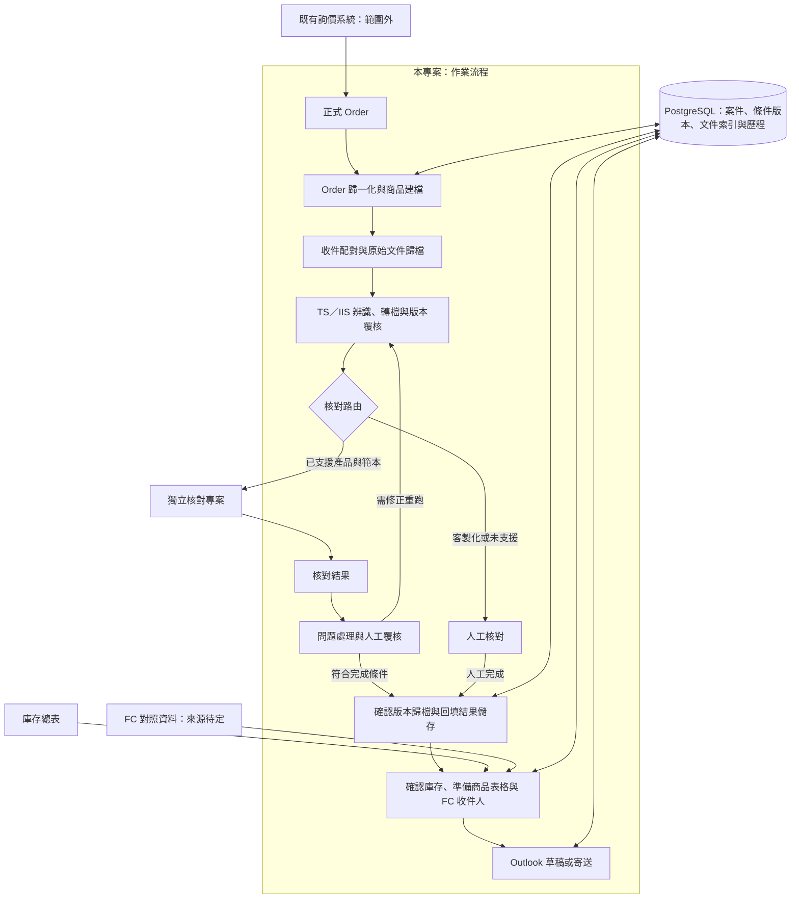

# 架構概觀／Architecture Overview

## 繁體中文

狀態：以下為規劃，並非已實作系統；已實作的只有「TS／IIS 準備」中的準備批次與放回資料夾（[#5](https://github.com/TaylorYam/structured-product-workflow/issues/5)，用法見 [README](../README.md)）。已確認需求見 [CONTEXT](../CONTEXT.md)。

### 模組與資料責任（建議）

本專案負責案件進度、Order 輸入、文件準備、歸檔、庫存讀取與寄送；核對專案負責文件解析及核對規則。正式 Order 經確認後提供參考條件表；庫存總表提供寄送資訊，兩者不互相默默覆蓋。

建議以內部案件編號支援尚未取得 TDCC 的階段，取得後再綁定。保存 Order 修訂、原始附件、轉檔輸出、人工決定與寄送紀錄。資料庫選用 PostgreSQL，詳見 [ADR 0001](adr/0001-postgresql-workflow-storage.md)；第一階段只存寄信與對帳需要的 FCN 資料，見 [ADR 0003](adr/0003-minimal-fcn-database.md)，信箱改由資料庫直接維護見 [ADR 0004](adr/0004-mailbox-maintained-in-database.md)；schema、多人併發實作及保存期限未定。

建議每階段獨立保存進度及重試；自動核對不通過不等於可直接寄送。人工核對須記錄人員、時間、結論及文件版本。原始與確認版本分開管理，附件使用已確認版本的指紋。

### 核對（`fcn_checker`）

核對程式與流程程式在同一個 repository、同一個套件（[ADR 0005](adr/0005-merge-checker-into-workflow.md)），但模組分開：`src/fcn_checker/` 負責 PDF 擷取、各上手範本解析、共用核對規則與回填，`src/sp_workflow/` 負責準備、放回、資料庫與寄信。兩者的資料目前只透過檔案銜接（標準檔名 PDF 與核對結果檔）；改成從資料庫讀條件、直接回填見 [ADR 0006](adr/0006-new-product-data-from-order.md)；新商品條件由「2 Order 條件」讀作業人員的起單建檔、確認後匯入（[ADR 0009](adr/0009-confirm-order-terms-in-window.md)、[ADR 0010](adr/0010-order-terms-from-daily-order-sheet.md)；期初定價日見 [ADR 0011](adr/0011-strike-date.md)）。商品條件寫入 `workflow.product` 只經過 `sp_workflow.product_write`（#124）：起單資料匯入、已鎖住更正（[ADR 0014](adr/0014-term-correction.md)）與人工維護（[ADR 0017](adr/0017-manual-maintenance-tab.md)、[ADR 0018](adr/0018-maintenance-trade-rows.md)）共用鎖列、確認打開後沒變、檢查、上手與面額、寫入、重算與紀錄的規則；核對寫回（`check_source.write_back`，[ADR 0013](adr/0013-check-from-database.md)）照舊比對核對時的參考條件表，只共用它的鎖。畫面只有一個 FCN Workflow 視窗（[ADR 0007](adr/0007-single-workflow-window.md)）：外殼與流程分頁在 `sp_workflow.app`；要連資料庫的按鈕各呼叫 `sp_workflow.window_actions` 的一個動作，連線、transaction 邊界與容錯（例如匯入成功、重算失敗時匯入保留，[ADR 0012](adr/0012-check-terms-calculation.md)）都在那裡，分頁只收輸入、在背景執行、顯示結果（#125）。`sp_workflow.app` import 核對頁 `fcn_checker.panel.CheckTab`、視窗共用的樣式與啟動參數，以及各頁共用的藍色提示條 `HintBar`、「下一步」按鈕 `NextButton`、頁首 `PageHeader`、重點數字 `KpiRow` 與配色（#83），以及結果表的複製元件：右鍵選單 `CopyMenu`、Treeview 的右鍵與 Ctrl+A／Ctrl+C `TableCopy`、「全部複製」那一列 `CopyArea`（#121）；步驟銜接時，外殼用 `CheckTab.receive_pdfs` 帶入準備好的 PDF、用 `on_saved` 得知核對存檔（#76）；反方向只有 `fcn-panel` 入口在函式裡呼叫 `sp_workflow.app` 開視窗。核對內部的資料流、模組邊界與決策見 [核對架構](checker/architecture.md) 與 [核對 ADR](checker/adr/README.md)（另一套編號）。

### 產品擴充（規劃）

Vanilla FCN 是目前優先範圍；EXPRESS FCN、BEN 是未來需求，尚未支援。產品類型、上手範本與樣態均需明確支援才走自動核對，未知或使用者指定時走人工。產品擴充的程式歸屬需另定，避免在流程專案複製核對規則。

### 執行環境與決策

公司 Windows、Outlook、Excel 與網路公槽是已知環境。先在本機開發 PostgreSQL，筆電與作業主機各有獨立資料庫，後續以公司伺服器支援協作為目標；公槽保存文件及備份。資料庫由本專案管理。核對專案已決定併入本專案（[ADR 0005](adr/0005-merge-checker-into-workflow.md)），新商品資料由 Order、交易明細與股價建立，核對直接讀寫資料庫（[ADR 0006](adr/0006-new-product-data-from-order.md)）；每日股價範本、單位面額與 Order 日期的規則見 [ADR 0008](adr/0008-daily-prices-denomination-and-order-dates.md)，Order 條件在視窗裡確認後匯入見 [ADR 0009](adr/0009-confirm-order-terms-in-window.md)，匯入後算出核對條件與放行差異見 [ADR 0012](adr/0012-check-terms-calculation.md)，核對從資料庫讀條件並寫回見 [ADR 0013](adr/0013-check-from-database.md)，鎖住後更正商品條件見 [ADR 0014](adr/0014-term-correction.md)，回補股價 CSV 見 [ADR 0015](adr/0015-price-csv-backfill.md)，商品條件可以部分空白、缺資料停在待確認見 [ADR 0016](adr/0016-partial-product-terms.md)，「7 人工維護」找出缺資料的商品、補齊與更正商品條件見 [ADR 0017](adr/0017-manual-maintenance-tab.md)，在人工維護修改交易明細見 [ADR 0018](adr/0018-maintenance-trade-rows.md)。詳見 [資料庫與部署](database-and-deployment.md)。實際主機、權限、郵件接法及資料政策待確認。[串接提案](checker-integration.md) 為待驗證建議。[待定事項](open-questions.md) 必須在相關實作前處理。Word 轉 PDF 使用 Microsoft Word，見 [ADR 0002](adr/0002-word-to-pdf-with-microsoft-word.md)。

## English

Status: proposed architecture, not implemented, except batch preparation and return to folders within TS/IIS preparation ([#5](https://github.com/TaylorYam/structured-product-workflow/issues/5); usage in the [README](../README.md)). Confirmed requirements are in [CONTEXT](../CONTEXT.md).

The diagram above connects formal Orders, normalization/booking, incoming archiving, TS/IIS preparation, checking routes, approved archiving, inventory lookup, and Outlook distribution. Inquiry stays external. Automatic checking is an independent project; customized or unsupported cases route to manual review. Failed automatic checks return for remediation or explicit review rather than proceeding directly to distribution.

### Module and data ownership (recommended)

This repository owns case progress, Order ingestion, document preparation, archives, inventory lookup, and distribution. The checker owns parsing and checking rules. Confirmed formal Orders supply the checking reference workbook; inventory supplies distribution information. Neither silently overwrites the other.

Use an internal case ID before TDCC is available, then bind it. Preserve Order revisions, original attachments, converted outputs, human decisions, and distribution records. PostgreSQL is selected; see [ADR 0001](adr/0001-postgresql-workflow-storage.md). The first phase stores only FCN data needed for mail and reconciliation; see [ADR 0003](adr/0003-minimal-fcn-database.md); the mailbox is maintained directly in the database per [ADR 0004](adr/0004-mailbox-maintained-in-database.md). Schema, concurrency implementation, and retention remain unresolved.

Persist progress and retry each stage independently. Manual checking records reviewer, time, conclusion, and document version. Separate incoming sources from approved versions; bind attachments to approved file hashes.

### Checking (`fcn_checker`)

The checker and the workflow share one repository and one package ([ADR 0005](adr/0005-merge-checker-into-workflow.md)) but stay separate modules: `src/fcn_checker/` owns PDF extraction, issuer template parsing, shared checking rules, and backfill; `src/sp_workflow/` owns preparation, returning, the database, and mail. Their data currently connects only through files (standard-name PDFs and the result workbook); reading terms from the database and backfilling directly is covered by [ADR 0006](adr/0006-new-product-data-from-order.md); new product terms come from the operators' daily order sheet, confirmed on "2 Order 條件" and imported ([ADR 0009](adr/0009-confirm-order-terms-in-window.md), [ADR 0010](adr/0010-order-terms-from-daily-order-sheet.md); the initial pricing date is in [ADR 0011](adr/0011-strike-date.md)). Product terms reach `workflow.product` only through `sp_workflow.product_write` (#124): the order-sheet import, locked-term corrections ([ADR 0014](adr/0014-term-correction.md)), and manual maintenance ([ADR 0017](adr/0017-manual-maintenance-tab.md), [ADR 0018](adr/0018-maintenance-trade-rows.md)) share its row locking, unchanged-since-opened check, validation, issuer and denomination rules, write, recalculation, and records; the check write-back (`check_source.write_back`, [ADR 0013](adr/0013-check-from-database.md)) still compares against the reference workbook used for checking and shares only its lock. There is one FCN Workflow window ([ADR 0007](adr/0007-single-workflow-window.md)): the shell and workflow tabs live in `sp_workflow.app`; each button that touches the database calls one action in `sp_workflow.window_actions`, which owns the connection, transaction boundaries, and failure handling (for example, an import that succeeded is kept when the recalculation after it fails, [ADR 0012](adr/0012-check-terms-calculation.md)), so the tabs only collect input, run the action in the background, and render the result (#125). `sp_workflow.app` imports the check tab `fcn_checker.panel.CheckTab`, the shared window style and launch arguments, and the shared blue hint bar `HintBar`, next-step button `NextButton`, page header `PageHeader`, key-figure row `KpiRow`, and palette (#83), plus the result-table copy widgets: the right-click menu `CopyMenu`, the Treeview right-click and Ctrl+A/Ctrl+C handler `TableCopy`, and the copy-all bar `CopyArea` (#121); for step handoffs the shell passes prepared PDFs in with `CheckTab.receive_pdfs` and learns about saved checks through `on_saved` (#76); in the other direction, only the `fcn-panel` entry point calls `sp_workflow.app` from inside a function to open the window. The checker's internal data flow, module boundaries, and decisions are in the [checker architecture](checker/architecture.md) and the [checker ADRs](checker/adr/README.md) (a separate numbering).

### Product expansion (planned)

Vanilla FCN is the priority. EXPRESS FCN and BEN are future needs, not supported capabilities. Automatic routing requires explicit support for product, issuer template, and variant; unknown or operator-selected cases use manual checking. Decide future rule ownership separately and avoid duplicating checking rules here.

### Runtime and decisions

Known environment: company Windows, Outlook, Excel, and shared folders. Develop PostgreSQL locally with independent laptop/operational databases, targeting a company server for collaboration. Shared folders hold documents/backups. This project owns persistence. The checker will be merged into this repository ([ADR 0005](adr/0005-merge-checker-into-workflow.md)); new product data is built from Orders, trade rows, and prices, and checking reads and writes the database directly ([ADR 0006](adr/0006-new-product-data-from-order.md)); the daily price template, denomination, and Order date rules are in [ADR 0008](adr/0008-daily-prices-denomination-and-order-dates.md), in-window confirmation of Order terms before import is in [ADR 0009](adr/0009-confirm-order-terms-in-window.md), calculating check terms and releasing differences after imports is in [ADR 0012](adr/0012-check-terms-calculation.md), checking against database terms with write-back is in [ADR 0013](adr/0013-check-from-database.md), correcting locked product terms is in [ADR 0014](adr/0014-term-correction.md), the price CSV backfill is in [ADR 0015](adr/0015-price-csv-backfill.md), partially blank product terms that stay 待確認 until filled are in [ADR 0016](adr/0016-partial-product-terms.md), the "7 人工維護" tab for finding products with missing data and filling in or correcting product terms is in [ADR 0017](adr/0017-manual-maintenance-tab.md), and editing trade rows there is in [ADR 0018](adr/0018-maintenance-trade-rows.md). See [database and deployment](database-and-deployment.md). Actual host, access, mail integration, and policies remain unresolved. The [integration proposal](checker-integration.md) requires validation; resolve relevant [open questions](open-questions.md) before implementation. Word-to-PDF conversion uses Microsoft Word; see [ADR 0002](adr/0002-word-to-pdf-with-microsoft-word.md).
