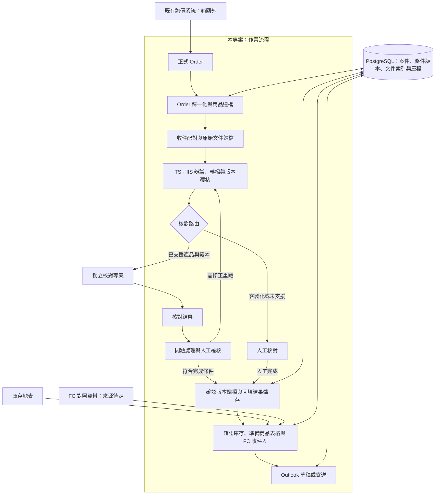

# 架構概觀／Architecture Overview

## 繁體中文

狀態：圖中「本專案：作業流程」已實作成一個 FCN Workflow 視窗（每日匯入、起單資料、準備、核對、放回、寄信草稿、人工維護、進度；用法見 [README](../README.md)）。圖裡的「獨立核對專案」已併入本 repo（`fcn_checker`，[ADR 0005](adr/0005-merge-checker-into-workflow.md)）；「庫存總表」與「FC 對照資料」改由資料庫裡的交易明細、商品條件與信箱表取代（[ADR 0004](adr/0004-mailbox-maintained-in-database.md)、[ADR 0006](adr/0006-new-product-data-from-order.md)）；「Outlook 草稿或寄送」目前只建草稿。已確認需求見 [CONTEXT](../CONTEXT.md)，尚未決定的見[待定事項](open-questions.md)。

### 模組與資料責任（建議）

本專案負責案件進度、Order 輸入、文件準備、歸檔、庫存讀取與寄送；核對專案負責文件解析及核對規則。正式 Order 經確認後提供參考條件表；庫存總表提供寄送資訊，兩者不互相默默覆蓋。

建議以內部案件編號支援尚未取得 TDCC 的階段，取得後再綁定。保存 Order 修訂、原始附件、轉檔輸出、人工決定與寄送紀錄。資料庫選用 PostgreSQL，詳見 [ADR 0001](adr/0001-postgresql-workflow-storage.md)；第一階段只存寄信與對帳需要的 FCN 資料，見 [ADR 0003](adr/0003-minimal-fcn-database.md)，信箱改由資料庫直接維護見 [ADR 0004](adr/0004-mailbox-maintained-in-database.md)，在視窗「維護」選單的「信箱維護…」新增、修改、刪除人員與別名、每次存檔留 `mailbox.change_log`（#158；寫入與資料庫檢查的原因在 `sp_workflow.mailbox`，視窗在 `sp_workflow.tabs.mailbox`）；信箱的型別與比對（人員 `Person`、名字比對 `Mailbox.match`、PB 判斷 `is_pb`、讀取 `load_mailbox`）也在 `sp_workflow.mailbox`，每日匯入、寄信草稿與交易明細都從那裡拿（#201）；各上手發行機構與保證機構的信用評等同樣在資料庫，保留生效日歷史，由「維護」選單的「發行機構評等…」維護（#237；`sp_workflow.credit_ratings`，視窗在 `sp_workflow.tabs.ratings`），依交易日取生效日在那天以前的最新一筆；自算風險等級（#238、[ADR 0023](adr/0023-self-calculated-risk-level.md)）由 `sp_workflow.risk_level` 跟著核對條件的重算一起算，用這份評等與每日股價的 200 日波動率，結果另存 `workflow.risk_level`，已鎖住的商品有了之後不再改變；標的拆股、合股由「維護」選單的「拆股登記…」登記（#270、[ADR 0024](adr/0024-stock-splits-in-observation.md)；`sp_workflow.stock_splits`，視窗在 `sp_workflow.tabs.splits`），存 `workflow.stock_split`，每次新增、刪除留只新增的 `workflow.stock_split_log`，比價時換算收盤價、不改商品價格；價格已經是上手調整過的標的，比價先推算價格基準日存在 `workflow.underlying_price.price_basis_date`，收盤價換到那天的基準（#275、[ADR 0025](adr/0025-price-basis-date.md)）；schema、多人併發實作及保存期限未定。

建議每階段獨立保存進度及重試；自動核對不通過不等於可直接寄送。人工核對須記錄人員、時間、結論及文件版本。原始與確認版本分開管理，附件使用已確認版本的指紋。

### 核對（`fcn_checker`）

核對程式與流程程式在同一個 repository、同一個套件（[ADR 0005](adr/0005-merge-checker-into-workflow.md)），但模組分開：`src/fcn_checker/` 負責 PDF 擷取、各上手範本解析、共用核對規則與回填，`src/sp_workflow/` 負責準備、放回、資料庫與寄信。兩者的資料目前只透過檔案銜接（標準檔名 PDF 與核對結果檔）；改成從資料庫讀條件、直接回填見 [ADR 0006](adr/0006-new-product-data-from-order.md)；新商品條件由「2 Order 條件」讀作業人員的起單建檔、確認後匯入（[ADR 0009](adr/0009-confirm-order-terms-in-window.md)、[ADR 0010](adr/0010-order-terms-from-daily-order-sheet.md)；期初定價日見 [ADR 0011](adr/0011-strike-date.md)）。商品條件寫入 `workflow.product` 只經過 `sp_workflow.product_terms`（#124、#203）：起單資料匯入、已鎖住更正（[ADR 0014](adr/0014-term-correction.md)）與人工維護（[ADR 0017](adr/0017-manual-maintenance-tab.md)、[ADR 0018](adr/0018-maintenance-trade-rows.md)）共用鎖列、確認打開後沒變、檢查、上手與面額、寫入、重算與紀錄的規則。對外主要是讀（`read_many`、只讀一檔的 `read`、`locked`）、組草稿（`draft_from`，草稿的 `Draft.mode` 由確認狀態 `status.OrderReview` 推出、決定走哪一套規則）、檢查（`problems`）、寫入（更正與人工維護一檔 `write`、起單資料整批 `write_batch`、回補既有的 FCN 以外商品建立鎖住的一檔 `create_backfilled`，#303）與核對寫回用的 `backfill`／`lock_checked`，另有起單資料設定 `load_import_config`、上手代號 `issuer_code` 與人工維護的「檢查」`missing_products`；核對寫回（`check_source.write_back`，[ADR 0013](adr/0013-check-from-database.md)）照舊比對核對時的參考條件表，回填值與鎖住都經過這兩個 function，和寫入共用同一把鎖。「一檔商品的條件怎麼讀」也只有 `product_terms.read_many` 知道（#204）：商品條件、核對條件、各標的價格、比價日、分公司配置與鎖住狀態一個回傳型別 `Stored`，caller 自己挑欄位；寄信草稿、核對讀資料庫與寫回、核對條件重算與放行、作業進度都經過它，比價、舊商品補資料與出場清單還是自己讀。起單資料匯入之後的重算與重讀在 `window_actions`。`workflow.product` 的欄、畫面的欄名與型別、必填欄（`REQUIRED`）和兩邊的轉換（KO／KI 代碼、UF = 100 − Upfront / NotePrice、單位面額預設）只在 `sp_workflow.product_record`（#126）：寫入、起單資料讀取、核對條件、核對讀資料庫與寄信草稿都從它拿；商品種類 `FCN` 與紀錄用的 `to_json` 也在這裡（#201）；它不 import 任何 `sp_workflow` module，`REQUIRED` 放在這裡就不會循環 import（[ADR 0016](adr/0016-partial-product-terms.md) 當時搬到 `order_terms` 的原因）。狀態字彙都在 `sp_workflow.status`（#202）：核對條件狀態 `CheckTerms`、比價狀態 `Pricing`、作業進度 `Progress`、存續狀態 `Lifecycle`、風險等級狀態 `Risk`（#238）與起單資料頁、人工維護的確認狀態 `OrderReview`，以及存進資料庫的起單資料匯入結果 `ImportResult`、商品來源 `ProductSource`（#203）各是一個 `StrEnum`，值就是資料庫、Excel 與畫面上的字串；各 module 原本的常數（例如 `check_terms.DONE`）是它的別名。畫面只有一個 FCN Workflow 視窗（[ADR 0007](adr/0007-single-workflow-window.md)）：外殼（頂端列、分兩組的步驟欄、「前往」與「維護」選單、關閉與啟動參數）在 `sp_workflow.app`，流程分頁一頁一個 module 在 `sp_workflow.tabs`（`daily`、`orders`、`prepare`、`returning`、`mail`、`manual`、`progress`、`exits`，名稱同 `PanelWindow` 的屬性；分頁共用的版面 `Tab`、根目錄、資料庫登入與背景動作的流程 `ActionRunner` 在 `tabs.base`，2、7 頁右邊的編輯區在 `tabs.editor`，7 頁的檢查結果表在 `tabs.cell_table`，1、2 頁共用的核對條件重算顯示與「放行差異…」在 `tabs.recalc`，#138）；要連資料庫的按鈕各呼叫 `sp_workflow.window_actions` 的一個動作，連線、transaction 邊界與容錯（例如匯入成功、重算失敗時匯入保留，[ADR 0012](adr/0012-check-terms-calculation.md)）都在那裡，分頁只收輸入、在背景執行、顯示結果（#125）；登入、一次只跑一件、停用與恢復按鈕、狀態列、例外顯示與連不上時忘記密碼都由 `ActionRunner` 做（`run_action`、不跳錯誤登入的 `run_maybe`、不連資料庫的 `run_local`），分頁、放行差異與信箱維護視窗都用它，分頁只寫 action 與顯示結果的 function（#206）。分頁傳給 `window_actions` 的參數由 `tests/test_action_contracts.py` 對照 function 的簽名，對調、漏傳或多傳都會失敗；`window_actions` 照舊是所有連資料庫動作的入口，只開連線、呼叫一個 function 的動作也不拆掉（#208 評估：其餘動作多半帶設定檔、假日表的讀法或複合步驟，拆掉會把這些搬進畫面程式）。資料表版本只在 `sp_workflow.database.connect` 檢查一次（版本不對丟 `SchemaOutdatedError`，不算登入問題、不忘掉密碼；遷移工具用不檢查的 `connect_raw`），吃連線的 module 不再各自檢查；「在呼叫端的 transaction 裡執行」的 function 開頭呼叫 `database.require_in_transaction`，沒有進行中的 transaction 時丟 `RuntimeError`（#205）；分頁結果直接顯示訊息的錯誤（以前 `tabs.base` 列的 13 個例外）都繼承 `database.OperatorError`，`ActionRunner` 只認這一個 base class（#200；信箱維護的 `MailboxError` 也是，#206）。「3 準備」「5 放回」「6 寄信草稿」也經過 `window_actions`：清單產出之後由 `sp_workflow.step_records` 為每檔寫一筆步驟紀錄 `workflow.step_record`（只新增、不修改；寫入失敗只寫在結果裡、不影響清單，#151、[ADR 0019](adr/0019-progress-step-records-and-lifecycle-events.md)）。存續狀態只看 `sp_workflow.lifecycle`：存續事件 `workflow.product_event` 只新增，自動事件（KO、接股、到期還本）只能由比價寫入、差異記在 `workflow.product_event_change`，人工只能登記顧客贖回與提出異議（`workflow.event_objection`），資料庫的 trigger 擋下修改與刪除（#152、[ADR 0019](adr/0019-progress-step-records-and-lifecycle-events.md)）；`workflow.product` 舊的 `status_event` 等四欄已由資料表版本 0020 移除（#172）。比價用的收盤價在 `sp_workflow.close_prices`：以實際收盤日＋去掉類別字的代碼存進 `workflow.close_price`，只存該代碼市場的交易日（用 `fcn_checker.trading_calendar` 的假日表判斷），來源是回補股價的 MarketData CSV（`daily_import.import_price_csv` 在同一個 transaction 裡寫）、每日更新的 BBG_Data（`daily_import.import_daily` 在同一個 transaction 裡寫，收盤日是各代碼市場在取價日之前最近的交易日，CSV 與歷史收盤價已有的不取代，#280、[ADR 0026](adr/0026-daily-update-writes-closes.md)）與維護選單一次匯入的歷史收盤價；以取價日為鍵的 `workflow.daily_price` 照舊只給核對條件用（#153、[ADR 0020](adr/0020-close-prices-and-observation-rules.md)）。作業進度只看 `sp_workflow.progress`：由交易明細、商品條件、核對條件、核對結果、鎖住時間與已寄出依序推出每檔一個進度（五個階段，其他步驟紀錄只顯示日期，#186），不另外存，比價狀態照 `workflow.pricing_status` 一起帶出（#170）；「8 進度」讀、篩選與匯出，也是登記已寄出（含依交易日批次登記，#186）、顧客贖回與提出、解除異議唯一的入口（經 `window_actions`，一檔一個 transaction，#156、#157、[ADR 0019](adr/0019-progress-step-records-and-lifecycle-events.md)）；批次登記已寄出寫入前用同一套事實再確認一次還是待寄信（`progress.still_pending_mail`），查詢自己一個 transaction、結束後才每檔各一個 transaction 寫入，中途失敗保留已寫的；已寄出過哪些檔問 `step_records.already_sent`，`window_actions` 不自己寫 SQL（#205）。出場清單只看 `sp_workflow.exits`：讀某一個收盤日（預設收盤價表最新的一天）還有效的 KO、接股、到期還本、顧客贖回，來源不限（比價、舊清單、人工，#188），不另外存；「9 出場清單」讀與匯出，每日匯入、回補股價、歷史收盤價比價完成後由外殼帶入比到的那一天（#171）。檔案 SHA-256 與各步驟寫出的簡單 Excel 表（準備、放回、寄信草稿清單、每日匯入、歷史收盤價與舊商品補資料的錯誤清單、資料庫參考條件表、商品匯出與進度匯出）共用 `sp_workflow.file_tools`：粗體表頭、凍結第一列、先寫暫存檔再換名；核對結果檔與回報包的 Excel 不用它（#139）；檔案寫不進去給作業人員看的錯誤是 `file_tools.FileWriteError`（#207）；商品匯出、進度與出場清單匯出共用 `file_tools.save_rows`（值照型別寫入、有篩選，#204 從 `product_export` 搬來）；商品總表（`product_export.export_summary`）自己排版（置中、依內容選字型、空值寫 `-`），用 `file_tools.excel_value`、`text_cell` 寫值、`save_export` 存檔（#291）；總表是 Excel 表格，後面接 `summary_analysis` 的分析分頁，用動態陣列公式從表格即時計算在庫部位，存檔時 `save_export(finish=summary_analysis.enable_spill)` 補上 openpyxl 不會寫的動態陣列中繼資料（#293）。匯入 pipeline（每日匯入、回補股價、收盤價、起單資料匯入、舊商品補資料、放回）共用兩個小 module（#207）：`sp_workflow.import_run` 記 run 紀錄（`open_run` 先記一筆、`finish_run` 補 summary，三張 run 表照舊）與寫錯誤清單（`error_book`，各 pipeline 的欄與工作表名不變）；`sp_workflow.sheet_cells` 是 Excel 格子的解讀（文字、TDCC、數字、百分比、金額、日期、彭博代碼），純 function、不碰資料庫，規則取自每日匯入，人工維護交易明細經 `daily_import.trade_value` 用同一套；規則不同的（起單建檔的 `order_terms.parse_field`、收盤價只收正數等）留在原處並註明差異。比價只在 `sp_workflow.observation`：`observe` 只算一檔（逐日比 KO、KI、到期，缺價格停住），不碰資料庫；`observe_all` 讀核對條件「完成」的商品與收盤價、算全部（已有存續事件的已出場、不再比，#169、[ADR 0021](adr/0021-stop-observing-exited-products.md)），第一次算出的自動事件經 `lifecycle.replace_auto_events` 寫入，每檔的比價狀態 `workflow.pricing_status` 有變才寫；`window_actions` 在回補股價與歷史收盤價匯入之後呼叫它，失敗時匯入保留（#155、[ADR 0020](adr/0020-close-prices-and-observation-rules.md)）。舊商品補價格與比價日在 `sp_workflow.legacy_backfill`：讀參考條件表格式的 Excel，只補已鎖住、還缺 `underlying_price` 或 `autocall_date` 的商品，庫存狀態經 `lifecycle.record_legacy` 寫成舊清單事件，一個 transaction（#154）。`sp_workflow.app` 從 `fcn_checker.panel` 只 import 核對頁 `CheckTab`；整個視窗共用的配色與樣式、圖示、各頁共用的藍色提示條 `HintBar`、「下一步」按鈕 `NextButton`、頁首 `PageHeader`、重點數字 `KpiRow`（#83）、結果表的複製元件（右鍵選單 `CopyMenu`、Treeview 的右鍵與 Ctrl+A／Ctrl+C `TableCopy`、「全部複製」那一列 `CopyArea`（`add_button` 在旁邊多放複製按鈕，例：進度頁的「複製待確認 TDCC」，#289），#121）、欄寬依內容自動調整的結果表 `FitTreeview`（#192）、平面的控制項（`apply_style` 全用 clam 內建元件，沒有外框的按鈕與勾選框跟著父元件的底色，#266）、多行文字框的外框 `FieldBox`、不用捲時藏起把手的捲軸 `Scrollbar` 與狀態列變綠的 `show_done`（發出 `STEP_DONE`／`STEP_UNDONE`，外殼的步驟欄據此打勾，#253）、中英夾雜也依寬度斷行的標籤 `WrapLabel`／`WrapTkLabel`（Tk 的 wraplength 只在空白處斷行，改用 `break_lines` 自己斷，#255），以及全視窗唯一的背景作業寫法 `Background`（每個分頁一個，動作依序在背景執行緒做、做完回主執行緒；外殼可以換成別的，測試用介面相同、馬上在同一個執行緒做完的 `ImmediateBackground`，#206）都在 `fcn_checker.ui`，核對頁與外殼都從那裡 import；日期欄位旁的小日曆 `DateEntry` 在 `fcn_checker.date_picker`（#192）；啟動參數 `parse_args`、`session_from_args` 由外殼擁有（#129）。外殼先建資料庫登入與核對的資料庫來源（`check_source.WorkflowDatabase`），核對工作階段建好時就帶著它；資料庫來源只在背景拿外殼登入過的連線設定、不問密碼，核對頁要連資料庫前請外殼在主執行緒登入（#129）。步驟銜接時，外殼用 `CheckTab.receive_pdfs` 帶入準備好的 PDF、用 `on_saved` 得知核對存檔，選了哪些 PDF 與條件來源讀核對工作階段（#76）；反方向只有 `fcn-panel` 入口在函式裡呼叫 `sp_workflow.app` 開視窗。核對內部的資料流、模組邊界與決策見 [核對架構](checker/architecture.md) 與 [核對 ADR](checker/adr/README.md)（另一套編號）。

### 產品擴充

Vanilla FCN 是目前優先範圍。FCN_Express 已併入同一套流程（[ADR 0027](adr/0027-fcn-express.md)）：支援的商品種類與各自的規則（目前是 Non-Call 範圍）集中在 `fcn_checker.products.PRODUCT_RULES`，每日匯入、起單資料匯入、人工維護共用，核對也照它檢查說明書推得的 Non-Call（#304）；寄信、商品總表不分商品種類；比價只有一條依商品種類的規則：Super Bull、BEN 的最終比價日不算 KO（`ProductRule.final_date_callable`，[ADR 0028](adr/0028-super-bull.md)）。BEN 只在到期判定（`ProductRule.maturity_only`，[ADR 0029](adr/0029-ben.md)）：起單匯入自動套 Non-Call = 天期、`Period End`、`NONE`，並多一欄參與率（`workflow.product.participation_pct`，參考條件表的選填欄）。自動核對依上手＋商品種類開放（`config/issuer_prefixes.toml` 的 `[auto_check_products]`，參考條件表的 Product 欄），目前 FCN 全部開放、FCN_Express 開放 Barclays、CA、HSBC（#304～#306）、Super Bull 開放 BNP、CA、HSBC（#311、#312、#314；只支援現行版範本與 KO 每期觀察＋非記憶式＋無 KI，辨識到的範本商品家族須和 Product 相同），沒開放的組合在辨識階段照不支援樣態攔下，走人工核對；BEN 已登記但還沒開放任何上手（#373，之後 HSBC → MS → CA）；規則仍在 `src/fcn_checker/`，不在流程程式複製。DACN、FCN_Stepdown 等其他商品尚未支援。

### 執行環境與決策

公司 Windows、Outlook、Excel 與網路公槽是已知環境。先在本機開發 PostgreSQL，筆電與作業主機各有獨立資料庫，後續以公司伺服器支援協作為目標；公槽保存文件及備份。資料庫由本專案管理。核對專案已決定併入本專案（[ADR 0005](adr/0005-merge-checker-into-workflow.md)），新商品資料由 Order、交易明細與股價建立，核對直接讀寫資料庫（[ADR 0006](adr/0006-new-product-data-from-order.md)）；每日股價範本、單位面額與 Order 日期的規則見 [ADR 0008](adr/0008-daily-prices-denomination-and-order-dates.md)，Order 條件在視窗裡確認後匯入見 [ADR 0009](adr/0009-confirm-order-terms-in-window.md)，匯入後算出核對條件與放行差異見 [ADR 0012](adr/0012-check-terms-calculation.md)，核對從資料庫讀條件並寫回見 [ADR 0013](adr/0013-check-from-database.md)，鎖住後更正商品條件見 [ADR 0014](adr/0014-term-correction.md)，回補股價 CSV 見 [ADR 0015](adr/0015-price-csv-backfill.md)，商品條件可以部分空白、缺資料停在待確認見 [ADR 0016](adr/0016-partial-product-terms.md)，「7 人工維護」找出缺資料的商品、補齊與更正商品條件見 [ADR 0017](adr/0017-manual-maintenance-tab.md)，在人工維護修改交易明細見 [ADR 0018](adr/0018-maintenance-trade-rows.md)，作業進度、步驟紀錄與存續事件見 [ADR 0019](adr/0019-progress-step-records-and-lifecycle-events.md)，收盤價資料與比價規則見 [ADR 0020](adr/0020-close-prices-and-observation-rules.md)。詳見 [資料庫與部署](database-and-deployment.md)。實際主機、權限、郵件接法及資料政策待確認。[串接提案](checker-integration.md) 為待驗證建議。[待定事項](open-questions.md) 必須在相關實作前處理。Word 轉 PDF 使用 Microsoft Word，見 [ADR 0002](adr/0002-word-to-pdf-with-microsoft-word.md)。

## English

Status: the "this repository: workflow" part of the diagram is implemented as one FCN Workflow window (daily import, order sheet, preparation, checking, return, mail drafts, manual maintenance, progress; usage in the [README](../README.md)). The diagram's "independent checker project" has been merged into this repository (`fcn_checker`, [ADR 0005](adr/0005-merge-checker-into-workflow.md)); the "inventory master" and "FC mapping data" are replaced by the trade rows, product terms, and mailbox table in the database ([ADR 0004](adr/0004-mailbox-maintained-in-database.md), [ADR 0006](adr/0006-new-product-data-from-order.md)); "Outlook draft or send" currently only creates drafts. Confirmed requirements are in [CONTEXT](../CONTEXT.md); undecided items are in [open questions](open-questions.md).

The diagram above connects formal Orders, normalization/booking, incoming archiving, TS/IIS preparation, checking routes, approved archiving, inventory lookup, and Outlook distribution. Inquiry stays external. Automatic checking lives in `fcn_checker` inside this repository; customized or unsupported cases route to manual review. Failed automatic checks return for remediation or explicit review rather than proceeding directly to distribution.

### Module and data ownership (recommended)

This repository owns case progress, Order ingestion, document preparation, archives, inventory lookup, and distribution. The checker owns parsing and checking rules. Confirmed formal Orders supply the checking reference workbook; inventory supplies distribution information. Neither silently overwrites the other.

Use an internal case ID before TDCC is available, then bind it. Preserve Order revisions, original attachments, converted outputs, human decisions, and distribution records. PostgreSQL is selected; see [ADR 0001](adr/0001-postgresql-workflow-storage.md). The first phase stores only FCN data needed for mail and reconciliation; see [ADR 0003](adr/0003-minimal-fcn-database.md); the mailbox is maintained directly in the database per [ADR 0004](adr/0004-mailbox-maintained-in-database.md), through 「信箱維護…」 in the window's 「維護」 menu, which adds, edits, and deletes people and aliases and records each save in `mailbox.change_log` (#158; writes and the reasons for database check failures live in `sp_workflow.mailbox`, the window in `sp_workflow.tabs.mailbox`); the mailbox types and matching (the `Person` type, name matching `Mailbox.match`, the PB check `is_pb`, and `load_mailbox`) also live in `sp_workflow.mailbox`, where the daily import, mail drafts, and trade rows take them from (#201). Issuer and guarantor credit ratings are likewise kept in the database with effective-date history and maintained through 「發行機構評等…」 in the 「維護」 menu (#237; `sp_workflow.credit_ratings`, window in `sp_workflow.tabs.ratings`); a trade date uses the latest rating effective on or before it. The self-calculated risk level (#238, [ADR 0023](adr/0023-self-calculated-risk-level.md)) is computed by `sp_workflow.risk_level` alongside the check-terms recalculation from these ratings and the daily prices' 200-day volatility, stored separately in `workflow.risk_level`, and never changes once a locked product has one. Underlying stock splits and consolidations are registered through 「拆股登記…」 in the 「維護」 menu (#270, [ADR 0024](adr/0024-stock-splits-in-observation.md); `sp_workflow.stock_splits`, window in `sp_workflow.tabs.splits`), stored in `workflow.stock_split` with an insert-only `workflow.stock_split_log` row for each add or delete; observation converts closes instead of changing product prices, and for underlyings whose prices the issuer already adjusted it first infers a price basis date, stored in `workflow.underlying_price.price_basis_date`, and converts closes to that basis (#275, [ADR 0025](adr/0025-price-basis-date.md)). Schema, concurrency implementation, and retention remain unresolved.

Persist progress and retry each stage independently. Manual checking records reviewer, time, conclusion, and document version. Separate incoming sources from approved versions; bind attachments to approved file hashes.

### Checking (`fcn_checker`)

The checker and the workflow share one repository and one package ([ADR 0005](adr/0005-merge-checker-into-workflow.md)) but stay separate modules: `src/fcn_checker/` owns PDF extraction, issuer template parsing, shared checking rules, and backfill; `src/sp_workflow/` owns preparation, returning, the database, and mail. Their data currently connects only through files (standard-name PDFs and the result workbook); reading terms from the database and backfilling directly is covered by [ADR 0006](adr/0006-new-product-data-from-order.md); new product terms come from the operators' daily order sheet, confirmed on "2 Order 條件" and imported ([ADR 0009](adr/0009-confirm-order-terms-in-window.md), [ADR 0010](adr/0010-order-terms-from-daily-order-sheet.md); the initial pricing date is in [ADR 0011](adr/0011-strike-date.md)). Product terms reach `workflow.product` only through `sp_workflow.product_terms` (#124, #203): the order-sheet import, locked-term corrections ([ADR 0014](adr/0014-term-correction.md)), and manual maintenance ([ADR 0017](adr/0017-manual-maintenance-tab.md), [ADR 0018](adr/0018-maintenance-trade-rows.md)) share its row locking, unchanged-since-opened check, validation, issuer and denomination rules, write, recalculation, and records. Its interface is mainly reading (`read_many`, the one-product `read`, `locked`), building a draft (`draft_from`; the draft's `Draft.mode`, derived from its review status `status.OrderReview`, picks the rules), checking (`problems`), writing (one correction or maintenance save with `write`, an order-sheet batch with `write_batch`, one locked product created by the existing non-FCN backfill with `create_backfilled`, #303), and `backfill`/`lock_checked` for the check write-back, plus the order-sheet settings `load_import_config`, the issuer code `issuer_code`, and the maintenance 檢查 `missing_products`; the check write-back (`check_source.write_back`, [ADR 0013](adr/0013-check-from-database.md)) still compares against the reference workbook used for checking, and writes its backfilled values and the lock through those two functions under the same row lock. How one product's terms are read is also known only to `product_terms.read_many` (#204): the terms, check terms, underlying prices, observation dates, branch allocation, and lock state come back as one type, `Stored`, and callers pick the fields they need; mail drafts, the database check source and write-back, the check-terms recalculation and release, and the workflow progress go through it, while observation, the legacy backfill, and the exit list still read on their own. Recalculating and reloading after an order-sheet import happen in `window_actions`. The `workflow.product` columns, the on-screen field names and kinds, the required fields (`REQUIRED`), and the conversions between them (KO/KI codes, UF = 100 − Upfront / NotePrice, the default denomination) live only in `sp_workflow.product_record` (#126): the writer, the order-sheet reader, check terms, the database check source, and mail drafts all take them from there; the product kind `FCN` and the record helper `to_json` live there too (#201); it imports no `sp_workflow` module, so keeping `REQUIRED` there avoids the circular import that moved it to `order_terms` in [ADR 0016](adr/0016-partial-product-terms.md). The status vocabularies live in `sp_workflow.status` (#202): the check-terms status `CheckTerms`, the observation status `Pricing`, the workflow progress `Progress`, the lifecycle status `Lifecycle`, the risk-level status `Risk` (#238), the review status of the order-sheet and maintenance tabs `OrderReview`, and the stored order-sheet import result `ImportResult` and product source `ProductSource` (#203) are each a `StrEnum` whose values are the strings stored in the database and shown in Excel and on screen; the modules' existing constants (for example `check_terms.DONE`) are aliases of them. There is one FCN Workflow window ([ADR 0007](adr/0007-single-workflow-window.md)): the shell (top bar, the step sidebar in two groups, the 前往 and 維護 menus, closing, and the launch arguments) lives in `sp_workflow.app`, and the workflow tabs live one module each in `sp_workflow.tabs` (`daily`, `orders`, `prepare`, `returning`, `mail`, `manual`, `progress`, `exits`, named after the `PanelWindow` attributes; the shared tab layout `Tab`, the root folder, the database login, and the background-action flow `ActionRunner` are in `tabs.base`, the editor on the right of tabs 2 and 7 in `tabs.editor`, tab 7's check-result table in `tabs.cell_table`, and the check-term recalculation display with the 放行差異 button shared by tabs 1 and 2 in `tabs.recalc`, #138); each button that touches the database calls one action in `sp_workflow.window_actions`, which owns the connection, transaction boundaries, and failure handling (for example, an import that succeeded is kept when the recalculation after it fails, [ADR 0012](adr/0012-check-terms-calculation.md)), so the tabs only collect input, run the action in the background, and render the result (#125); logging in, running one action at a time, disabling and restoring buttons, the status line, showing exceptions, and forgetting the password when the database is unreachable are all done by `ActionRunner` (`run_action`, `run_maybe` that logs in without error dialogs, and `run_local` that needs no database), which the tabs, the 放行差異 button, and the mailbox maintenance window all use, so a tab only writes the action and the function that shows its result (#206). `tests/test_action_contracts.py` checks the arguments each tab passes to `window_actions` against the function's signature, so a swapped, missing, or extra argument fails; `window_actions` stays the single entry point for every database action, including those that only open a connection and call one function (the #208 evaluation: most other actions also load settings files or the holiday calendar, or combine steps, and removing them would move that into the UI code). The schema version is checked once, in `sp_workflow.database.connect` (an outdated schema raises `SchemaOutdatedError`, which is not a login problem and does not forget the password; the migration tool uses the unchecked `connect_raw`), so modules that take a connection no longer check it themselves; functions that run in the caller's transaction start with `database.require_in_transaction`, which raises `RuntimeError` when no transaction is open (#205); the errors whose message a tab shows as is (the 13 exceptions `tabs.base` used to list) all derive from `database.OperatorError`, the only base class `ActionRunner` recognizes (#200; the mailbox maintenance `MailboxError` is one too, #206). "3 準備", "5 放回", and "6 寄信草稿" also go through `window_actions`: after the list is produced, `sp_workflow.step_records` writes one step record per product to `workflow.step_record` (insert-only; a failed write is reported in the result and never affects the list, #151, [ADR 0019](adr/0019-progress-step-records-and-lifecycle-events.md)). The lifecycle status comes only from `sp_workflow.lifecycle`: lifecycle events in `workflow.product_event` are insert-only, automatic events (KO, 接股, 到期還本) are written only by observation with the difference recorded in `workflow.product_event_change`, people can only record 顧客贖回 and raise objections (`workflow.event_objection`), and database triggers block edits and deletes (#152, [ADR 0019](adr/0019-progress-step-records-and-lifecycle-events.md)); the old `status_event` column and its three companions were dropped from `workflow.product` by schema version 0020 (#172). Close prices for observation live in `sp_workflow.close_prices`: `workflow.close_price` is keyed by the actual closing day and the code without its class word, and stores only trading days of the code's market (decided with the `fcn_checker.trading_calendar` holiday calendar); its sources are the MarketData CSV of the price backfill (`daily_import.import_price_csv` writes it in the same transaction), the daily update's BBG_Data (`daily_import.import_daily` writes it in the same transaction; the closing day is the latest trading day of each code's market before the price date, and closes from a CSV or the historical import are not replaced, #280, [ADR 0026](adr/0026-daily-update-writes-closes.md)), and the one-off historical close import on the maintenance menu, while the price-date `workflow.daily_price` still serves check terms only (#153, [ADR 0020](adr/0020-close-prices-and-observation-rules.md)). The workflow progress comes only from `sp_workflow.progress`, which derives one stage per product in order from trade rows, product terms, check terms, check results, the lock time, and 已寄出 (five stages; other step records only show their dates, #186), and stores nothing, carrying the observation status from `workflow.pricing_status` alongside (#170); "8 進度" reads, filters, and exports it and is the only place to record 已寄出 (including a batch by trade date, #186), customer redemptions, and to raise or resolve objections (through `window_actions`, one transaction per product, #156, #157, [ADR 0019](adr/0019-progress-step-records-and-lifecycle-events.md)); before writing, the batch 已寄出 checks again with the same facts that each product is still 待寄信 (`progress.still_pending_mail`) in a transaction of its own that ends before the writes, then writes each product in its own transaction, so a failure midway keeps the ones already written; which products were already sent comes from `step_records.already_sent`, and `window_actions` writes no SQL of its own (#205). The exit list comes only from `sp_workflow.exits`, which reads the current KO, 接股, 到期還本, and 顧客贖回 events of any source (比價, 舊清單, 人工, #188) on one closing day (by default the latest day in the close-price table) and stores nothing; "9 出場清單" reads and exports it, and the shell hands it the day observation reached after the daily import, the price backfill, and the historical close import (#171). File SHA-256 and the simple Excel sheets the steps write (preparation, return, and mail-draft lists, the daily-import, historical-close, and legacy-backfill error lists, the database reference sheet, the product and progress exports) share `sp_workflow.file_tools`: bold header, frozen first row, and writing a temporary file before renaming; the checker result file and report bundle workbooks do not use it (#139); a file that cannot be written raises the operator-facing `file_tools.FileWriteError` (#207); the product, progress, and exit-list exports share `file_tools.save_rows` (values written by type, with a filter; moved from `product_export` in #204), while the product summary (`product_export.export_summary`) lays out its own sheet (centred, fonts by content, `-` for missing values) and writes values with `file_tools.excel_value` and `text_cell` and saves with `save_export` (#291); the summary is an Excel table followed by `summary_analysis` sheets whose dynamic-array formulas compute in-stock positions from the table live, and `save_export(finish=summary_analysis.enable_spill)` adds the dynamic-array metadata openpyxl does not write (#293). The import pipelines (daily import, price backfill, close prices, order-sheet import, legacy backfill, returning) share two small modules (#207): `sp_workflow.import_run` records runs (`open_run` inserts the row, `finish_run` fills in the summary; the three run tables are unchanged) and writes error lists (`error_book`; each pipeline keeps its columns and sheet name), and `sp_workflow.sheet_cells` reads Excel cells (text, TDCC, numbers, percentages, amounts, dates, Bloomberg codes) as pure functions without the database, with the daily-import rules, which manual trade-row edits share through `daily_import.trade_value`; readers with different rules (the order sheet's `order_terms.parse_field`, positive-only close prices, and so on) stay where they are with the difference noted. Observation lives only in `sp_workflow.observation`: `observe` handles one product (KO, KI, and maturity day by day, stopping at a missing price) without touching the database; `observe_all` reads the products whose check terms are 完成 and their closes, runs them all (products with a lifecycle event have exited and are skipped, #169, [ADR 0021](adr/0021-stop-observing-exited-products.md)), writes newly found automatic events through `lifecycle.replace_auto_events`, and writes each product's `workflow.pricing_status` only when it changes; `window_actions` calls it after the price backfill and the historical close import, keeping the import when it fails (#155, [ADR 0020](adr/0020-close-prices-and-observation-rules.md)). The old-product backfill lives in `sp_workflow.legacy_backfill`: it reads a reference-workbook-format Excel, fills only locked products still lacking `underlying_price` or `autocall_date`, and writes the 庫存狀態 as 舊清單 events through `lifecycle.record_legacy`, all in one transaction (#154). `sp_workflow.app` imports only the check tab `CheckTab` from `fcn_checker.panel`; the shared palette and style, icon, the shared blue hint bar `HintBar`, next-step button `NextButton`, page header `PageHeader`, key-figure row `KpiRow` (#83), the result-table copy widgets (the right-click menu `CopyMenu`, the Treeview right-click and Ctrl+A/Ctrl+C handler `TableCopy`, and the copy-all bar `CopyArea`, whose `add_button` adds further copy buttons such as 複製待確認 TDCC on the progress tab (#289), #121), the content-sized result table `FitTreeview` (#192), the flat controls (`apply_style` uses only clam's built-in elements; borderless buttons and checkboxes take the parent's background, #266), the frame for multi-line text boxes `FieldBox`, the scrollbar `Scrollbar` that hides its thumb when nothing scrolls, and `show_done`, which turns the status line green and sends `STEP_DONE`/`STEP_UNDONE` so the shell's sidebar checks that step (#253), the labels `WrapLabel`/`WrapTkLabel` that wrap mixed Chinese and English text by width (Tk's wraplength breaks only at spaces, so `break_lines` breaks the lines itself, #255), and the window's single background-work helper `Background` (one per tab; actions run in order on a worker thread and report back on the main thread; the shell can be given another one, such as `ImmediateBackground` for tests, which has the same interface and finishes each action at once on the same thread, #206) live in `fcn_checker.ui`, which both the check tab and the shell import; the calendar button beside date fields, `DateEntry`, lives in `fcn_checker.date_picker` (#192); the shell owns the launch arguments `parse_args` and `session_from_args` (#129). The shell builds the database login and the check's database source (`check_source.WorkflowDatabase`) first, and the check session receives that source when it is constructed; the source only reads the shell's logged-in connection settings in the background and never prompts, and the check tab asks the shell to log in on the main thread before it touches the database (#129). For step handoffs the shell passes prepared PDFs in with `CheckTab.receive_pdfs`, learns about saved checks through `on_saved`, and reads the chosen PDFs and terms source from the check session (#76); in the other direction, only the `fcn-panel` entry point calls `sp_workflow.app` from inside a function to open the window. The checker's internal data flow, module boundaries, and decisions are in the [checker architecture](checker/architecture.md) and the [checker ADRs](checker/adr/README.md) (a separate numbering).

### Product expansion

Vanilla FCN is the priority. FCN_Express now follows the same workflow ([ADR 0027](adr/0027-fcn-express.md)): supported product types and their rules (currently the Non-Call range) live in `fcn_checker.products.PRODUCT_RULES`, shared by the daily import, the order import, and manual maintenance, and the checker uses it to check the Non-Call derived from the term sheet (#304); mail drafts and the product master ignore the product type, and observation has one product-type rule: Super Bull and BEN never count the final valuation date as KO (`ProductRule.final_date_callable`, [ADR 0028](adr/0028-super-bull.md)). BEN is only decided at maturity (`ProductRule.maturity_only`, [ADR 0029](adr/0029-ben.md)): the order import applies Non-Call equal to the tenor, `Period End`, and `NONE`, and BEN has a participation rate (`workflow.product.participation_pct`, an optional reference-sheet column). Automatic checking is opened per issuer and product type (`[auto_check_products]` in `config/issuer_prefixes.toml`, plus the reference sheet's Product column); FCN is open for every issuer, FCN_Express for Barclays, CA, and HSBC (#304-#306), and Super Bull for BNP, CA, and HSBC (#311, #312, #314; only the current template version and periodic, non-memory KO without KI, and the detected template family must match Product); combinations not opened are stopped at identification like unsupported variants and checked by hand. BEN is registered but not opened for any issuer yet (#373; HSBC, then MS and CA). Checking rules stay in `src/fcn_checker/` and are not duplicated in the workflow code. DACN, FCN_Stepdown, and other products are not supported yet.

### Runtime and decisions

Known environment: company Windows, Outlook, Excel, and shared folders. Develop PostgreSQL locally with independent laptop/operational databases, targeting a company server for collaboration. Shared folders hold documents/backups. This project owns persistence. The checker will be merged into this repository ([ADR 0005](adr/0005-merge-checker-into-workflow.md)); new product data is built from Orders, trade rows, and prices, and checking reads and writes the database directly ([ADR 0006](adr/0006-new-product-data-from-order.md)); the daily price template, denomination, and Order date rules are in [ADR 0008](adr/0008-daily-prices-denomination-and-order-dates.md), in-window confirmation of Order terms before import is in [ADR 0009](adr/0009-confirm-order-terms-in-window.md), calculating check terms and releasing differences after imports is in [ADR 0012](adr/0012-check-terms-calculation.md), checking against database terms with write-back is in [ADR 0013](adr/0013-check-from-database.md), correcting locked product terms is in [ADR 0014](adr/0014-term-correction.md), the price CSV backfill is in [ADR 0015](adr/0015-price-csv-backfill.md), partially blank product terms that stay 待確認 until filled are in [ADR 0016](adr/0016-partial-product-terms.md), the "7 人工維護" tab for finding products with missing data and filling in or correcting product terms is in [ADR 0017](adr/0017-manual-maintenance-tab.md), editing trade rows there is in [ADR 0018](adr/0018-maintenance-trade-rows.md), workflow progress with step records and lifecycle events is in [ADR 0019](adr/0019-progress-step-records-and-lifecycle-events.md), and close prices with the observation rules are in [ADR 0020](adr/0020-close-prices-and-observation-rules.md). See [database and deployment](database-and-deployment.md). Actual host, access, mail integration, and policies remain unresolved. The [integration proposal](checker-integration.md) requires validation; resolve relevant [open questions](open-questions.md) before implementation. Word-to-PDF conversion uses Microsoft Word; see [ADR 0002](adr/0002-word-to-pdf-with-microsoft-word.md).
