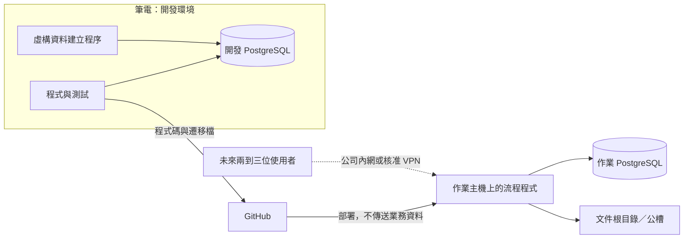

# 資料庫與部署／Database and Deployment

## 繁體中文

狀態：PostgreSQL 選型已記錄於 [ADR 0001](adr/0001-postgresql-workflow-storage.md)。已完成本機 PostgreSQL 測試連線及第一批庫存 Excel 的測試匯入；正式作業 schema、遷移流程與部署仍待另行確認。

### 資料責任

| 來源／儲存 | 責任 |
|---|---|
| 正式 Order | 確認後的核對條件來源，保留修訂及原信證據 |
| PostgreSQL | 案件、正式條件版本、文件版本、核對執行、進度與操作歷史；其他模組逐步加入 |
| 公槽／開發文件根目錄 | 原始信件附件、Word、PDF、核對輸出；資料庫保存位置與指紋 |
| 庫存總表 Excel | 在明確遷移前維持庫存與郵件商品資訊來源；資料庫可保存來源版本與快照 |
| 匯出 Excel | 作業清單、分析、交付與核對交換檔；修改匯出檔不自動更新資料庫 |

可匯出商品、成交、配息到期、待處理案件與分析結果。匯回修改須另有驗證及確認流程。統一資料管理不表示立即取代所有 Excel 或把 PDF 存成資料庫二進位欄位。

### 最小開發切片（建議，非已批准的實作工單）

先建立商品案件、正式條件版本、文件版本、核對執行紀錄。用虛構商品走完：建案 → 選定正式條件及文件 → 呼叫核對工具 → 保存逐商品結果 → 查詢／匯出 Excel。實際 schema、程式語言、ORM 與遷移工具待定。

條件草稿與正式版本分開；金額、利率等欄位需明訂精度、單位、捨入與型別。TDCC 以文字保存前導零。交易與唯一限制可保護資料庫更新，但不能讓 Outlook 寄信和資料庫更新成為同一個可撤回事務；寄送需另有工作識別、狀態及不確定結果處理。

### 核對串接

流程 APP 選商品案件後，由 PostgreSQL 取得已確認條件與確切文件版本。初期可自動產生現有工具所需的參考條件表 Excel，再呼叫 CLI；使用者不需手動選 Excel。此為目標行為，現有 checker 仍接收 Excel。結構化輸入及正式結果格式是後續跨專案工單，尚未存在。

結果回存需分開：完整核對紀錄、允許回填欄位、案件進度。依既有規則驗證後才回填 ISIN／日期等候選值；差異不覆蓋正式 Order。保存 run ID、條件版本、文件 hash、checker／設定版本。回存時若正式條件或文件選擇已變，保留舊 run 但不把目前版本標示通過；同一 run 重複匯入須能辨識。

### 開發與部署

#### 庫存 Excel 第一次測試匯入

`scripts/` 的 PostgreSQL 工具需要選用的 `db` 套件：`python -m pip install -c constraints.txt -e ".[dev,db]"`。不用資料庫的人照 README 安裝 `.[dev]` 即可。

測試匯入器位於 `scripts/import_inventory_excel.py`，會主動讀取本機 `.env`；`.env` 必須維持在 Git ignore 範圍內，密碼不得寫入 repository、log 或輸出。匯入器預設只做 dry-run：

```text
python scripts/import_inventory_excel.py --excel <path> --sheet 工作表1 --env-file .env --check-connection
python scripts/import_inventory_excel.py --excel <path> --sheet 工作表1 --env-file .env --dry-run
python scripts/import_inventory_excel.py --excel <path> --sheet 工作表1 --env-file .env --write
```

第一次測試匯入使用 `(source_sha256, sheet_name, config_sha256)` 識別相同檔案、工作表與匯入設定的重跑。寫入在單一 transaction 中建立測試匯入表、保存原始 Excel 列、標準化 TDCC 商品、分公司配置及標的明細；失敗時整批 rollback，既有資料不刪除也不覆蓋。正式作業 schema、migration 及欄位規則仍需獨立審查。



- 筆電與作業主機各有獨立資料庫，開發不必連正式資料庫。主要版本與擴充盡量一致。
- 主機、port、database、帳號與文件根目錄採環境設定。憑證不進 Git；APP 使用專用帳號，管理及 schema 更新權限分開設計。
- 遷移檔版本化，開發先驗證，再於作業環境備份並執行。破壞性變更與還原計畫需另審查；不手動在兩台各自改表而不留紀錄。
- 文件保存相對路徑與 hash，以環境設定指定根目錄，避免綁定個人磁碟代號。
- 不能用 Git 同步正在運作的資料庫目錄。使用 PostgreSQL 支援的備份／還原方式；一致備份可以放公槽，需有還原演練與存取權限。
- 首次試行資料搬遷需明確決定保留內容，不能把虛構資料誤當正式資料。切換時停止舊端寫入、備份還原、驗證資料及文件，再切換連線；切換後只有一份正式寫入來源。
- 公司伺服器承載後不再依賴個人電腦；若暫用個人桌機，關機仍中斷服務。未來可由共同流程服務統一授權與併發控制，實際介面尚未選定。不直接把資料庫連接埠暴露到網際網路。

### 時間軸與分析

案件逐步累積：Order／建檔 → 收件 → 文件準備 → 核對／人工覆核 → 確認歸檔與回填 → 等待庫存 → 郵件準備／寄送。保存事件歷史而非只覆蓋目前狀態，文件修訂產生新版本與新核對 run。狀態名稱及完成門檻尚待定。

四年 FCN 分析需先盤點資料。商品條件、成交、配息及提前出場／到期事件是不同的一對多資料，不能全塞入每商品一列。只有發行條件不能推導實際收益；回測還需行情與完整產品規則。初期可在同一 PostgreSQL 提供唯讀分析查詢／檢視表與 Excel 匯出；是否另建分析資料庫依負載再評估。

## English

Status: PostgreSQL selection is recorded in [ADR 0001](adr/0001-postgresql-workflow-storage.md). The local PostgreSQL connection and the first inventory-Excel test import are complete. The operational schema, migration process, and deployment remain subject to separate confirmation.

### Data ownership

Formal Orders remain the confirmed checking-term source with revisions and evidence. PostgreSQL stores cases, confirmed-term versions, document versions, check runs, progress, and audit history. Shared folders or a development document root hold original attachments, Word/PDF, and checker outputs; the database stores locations and hashes. Inventory Excel remains authoritative for inventory and email information until an explicit migration, with source snapshots optionally recorded in PostgreSQL. Exported Excel supports lists, analysis, delivery, and checker exchange; edits require a separate validated import and do not automatically update the database.

### Minimal development slice (recommended, not an approved implementation ticket)

Start with cases, term versions, document versions, and check runs. Use synthetic data to create a case, select confirmed terms/documents, invoke the checker, persist per-product results, and query/export Excel. Schema, language, ORM, and migration tooling are unresolved.

Separate draft and confirmed terms; specify precision, units, rounding, and types for money/rates. Store TDCC as text to preserve leading zeros. Transactions and uniqueness protect database changes but cannot roll back Outlook sending; mail needs separate job identity, states, and uncertain-outcome handling.

### Checker integration

The workflow reads confirmed terms and selected document versions from PostgreSQL. Initially it may generate the existing reference Excel automatically and invoke the CLI, removing manual Excel selection. This is target behavior; the current checker still accepts Excel. Structured inputs and a stable result contract need separate cross-repository work.

Persist full results, allowed backfills, and case progress separately. Validate ISIN/date candidates under existing rules; discrepancies never overwrite formal Order terms. Bind each run to its term version, document hashes, checker/configuration versions. If current terms or selected documents change, retain the old run without marking the new version passed. Detect repeated imports of the same run.

### Development and deployment

#### First inventory Excel test import

The PostgreSQL tools in `scripts/` need the optional `db` extra: `python -m pip install -c constraints.txt -e ".[dev,db]"`. Without a database, install `.[dev]` as described in the README.

The test importer is `scripts/import_inventory_excel.py`. It actively loads the local `.env`; `.env` must remain covered by Git ignore, and passwords must not enter the repository, logs, or output. The importer defaults to a dry-run:

```text
python scripts/import_inventory_excel.py --excel <path> --sheet 工作表1 --env-file .env --check-connection
python scripts/import_inventory_excel.py --excel <path> --sheet 工作表1 --env-file .env --dry-run
python scripts/import_inventory_excel.py --excel <path> --sheet 工作表1 --env-file .env --write
```

The first test import identifies reruns with `(source_sha256, sheet_name, config_sha256)`. A write runs in one transaction and creates the test-import tables, preserves raw Excel rows, and stores normalized TDCC products, branch allocations, and underlying details. A failure rolls back the batch; existing data is neither deleted nor overwritten. The operational schema, migrations, and final field rules require separate review.

The diagram above separates laptop code/tests and a development PostgreSQL from the operational host/database. GitHub transfers code and migrations, not business data. Future users connect through the company network or an approved VPN.

Use independent development and operational databases with matching major versions/extensions where practical. Configure host, port, database, account, and document root per environment; keep credentials outside Git and separate application privileges from administration/migration privileges. Version schema migrations, test in development, then back up and apply operationally. Review destructive changes and restore plans separately.

Store relative document paths and hashes. Never synchronize live data directories through Git. Use supported PostgreSQL backup/restore methods; consistent backups may be stored on the share with access control and restore exercises. During initial migration explicitly select retained pilot data, stop old writes, back up/restore, validate records and files, then switch clients to one authoritative write location. Routine deployments never replace operational data with development data.

A company-managed host removes dependence on a personal computer; a temporary personal host must remain online. A shared workflow service is a recommended future authorization/concurrency mechanism, not a selected interface. Do not expose database ports directly to the internet. Desktop Word/Outlook dependencies require separate deployment evaluation.

### Timeline and analysis

Accumulate case history through Order/booking, receipt, preparation, checking/manual review, approved archiving/backfill, inventory readiness, and distribution. Preserve events and revisions rather than only overwriting current state. State names and gates remain unresolved.

Inventory historical sources before four-year analysis. Product terms, trades, coupons, and early-redemption/maturity events are distinct one-to-many data. Issuance terms alone do not establish realized returns; backtests also require market data and complete rules. Initially use read-only queries/views and Excel exports in the same PostgreSQL; assess separate analytics storage based on workload.
