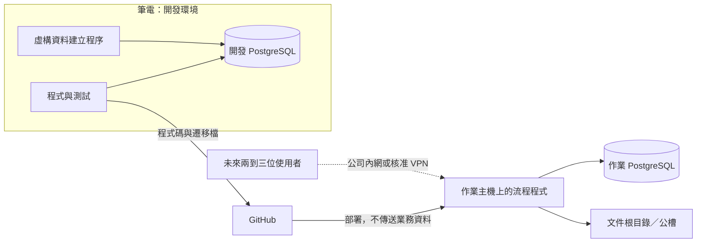

# 資料庫與部署／Database and Deployment

## 繁體中文

狀態：PostgreSQL 選型已記錄於 [ADR 0001](adr/0001-postgresql-workflow-storage.md)。已完成本機 PostgreSQL 測試連線及第一批庫存 Excel 的測試匯入；正式作業主機與部署仍待另行確認。作業安裝器會以安裝資料夾的 `.env` 自動套用已版本化的資料表遷移。

### 資料責任

| 來源／儲存 | 責任 |
|---|---|
| 正式 Order | 確認後的核對條件來源，保留修訂及原信證據 |
| PostgreSQL | 案件、正式條件版本、文件版本、核對執行、進度與操作歷史；其他模組逐步加入 |
| 公槽／開發文件根目錄 | 原始信件附件、Word、PDF、核對輸出；資料庫保存位置與指紋 |
| 庫存總表 Excel | 在明確遷移前維持庫存與郵件商品資訊來源；資料庫可保存來源版本與快照 |
| 匯出 Excel | 作業清單、分析、交付與核對交換檔；修改匯出檔不自動更新資料庫 |

可匯出商品、成交、配息到期、待處理案件與分析結果。匯回修改須另有驗證及確認流程。統一資料管理不表示立即取代所有 Excel 或把 PDF 存成資料庫二進位欄位。

### 最小開發切片（建議，非已批准的實作工單）

先建立商品案件、正式條件版本、文件版本、核對執行紀錄。用虛構商品走完：建案 → 選定正式條件及文件 → 呼叫核對工具 → 保存逐商品結果 → 查詢／匯出 Excel。實際 schema、程式語言、ORM 與遷移工具待定。

條件草稿與正式版本分開；金額、利率等欄位需明訂精度、單位、捨入與型別。TDCC 以文字保存前導零。交易與唯一限制可保護資料庫更新，但不能讓 Outlook 寄信和資料庫更新成為同一個可撤回事務；寄送需另有工作識別、狀態及不確定結果處理。

### 核對串接

流程 APP 選商品案件後，由 PostgreSQL 取得已確認條件與確切文件版本。初期可自動產生現有工具所需的參考條件表 Excel，再呼叫 CLI；使用者不需手動選 Excel。此為目標行為，現有 checker 仍接收 Excel。結構化輸入及正式結果格式是後續跨專案工單，尚未存在。

結果回存需分開：完整核對紀錄、允許回填欄位、案件進度。依既有規則驗證後才回填 ISIN／日期等候選值；差異不覆蓋正式 Order。保存 run ID、條件版本、文件 hash、checker／設定版本。回存時若正式條件或文件選擇已變，保留舊 run 但不把目前版本標示通過；同一 run 重複匯入須能辨識。

### 開發與部署

#### 庫存 Excel 第一次測試匯入

第一階段的正式資料表與每日匯入見 [ADR 0003](adr/0003-minimal-fcn-database.md) 與 README「每日匯入」：資料表版本在套件的 `migrations/`，以 `spw-db-migrate` 套用；作業安裝／更新時，`setup_panel.cmd` 會使用安裝資料夾的 `.env` 自動套用尚未執行的版本；開發或手動遷移時請明確使用 `spw-db-migrate --env-file .env`。換電腦以「建立資料表＋重新匯入」重建，不複製資料庫。以下 `scripts/` 的測試匯入表是早期試作，不被正式流程使用。PostgreSQL 驅動已包含在套件裡。資料表版本 0012（[#114](https://github.com/TaylorYam/structured-product-workflow/issues/114)、[ADR 0016](adr/0016-partial-product-terms.md)）起，商品條件的必填欄可以空白（缺資料的商品停在待確認）；套用 migration 不會覆蓋既有商品資料。資料表版本 0014（[#116](https://github.com/TaylorYam/structured-product-workflow/issues/116)、[ADR 0018](adr/0018-maintenance-trade-rows.md)）新增 `workflow.trade_row_correction`，記人工維護改了哪些交易明細。資料表版本 0015（[#151](https://github.com/TaylorYam/structured-product-workflow/issues/151)、[ADR 0019](adr/0019-progress-step-records-and-lifecycle-events.md)）新增 `workflow.step_record`，記準備、放回、建草稿（與之後進度頁登記的已寄出）的步驟紀錄，只新增、不修改，不動既有資料。資料表版本 0016（[#152](https://github.com/TaylorYam/structured-product-workflow/issues/152)、[ADR 0019](adr/0019-progress-step-records-and-lifecycle-events.md)）新增存續事件 `workflow.product_event`、取代紀錄 `workflow.product_event_change` 與異議 `workflow.event_objection`，並把既有商品不是「在庫」的 `status_event` 轉成來源「舊清單」的事件（事件日、標的、備註取 `status_date`、`status_underlying`、`status_raw`）；原欄位保留、值不動，只是 `status_event` 改成允許空白，之後由版本 0020 移除。資料表版本 0017（[#153](https://github.com/TaylorYam/structured-product-workflow/issues/153)、[ADR 0020](adr/0020-close-prices-and-observation-rules.md)）新增收盤價 `workflow.close_price`（實際收盤日＋代碼）、每次匯入一筆的 `workflow.close_price_import` 與值被取代時的舊值 `workflow.close_price_change`；`workflow.daily_price` 與其他既有資料不動，收盤價要另外匯入（每天的 MarketData CSV、一次性的歷史收盤價）。資料表版本 0018（[#155](https://github.com/TaylorYam/structured-product-workflow/issues/155)、[ADR 0020](adr/0020-close-prices-and-observation-rules.md)）新增比價狀態 `workflow.pricing_status`（每檔一筆：狀態、原因、已比到的日期、是否鎖住），不動既有資料；升級後第一次匯入收盤價或按「重新比價全部」才會寫。資料表版本 0019（[#158](https://github.com/TaylorYam/structured-product-workflow/issues/158)）新增 `mailbox.change_log`，記「信箱維護…」視窗每次存檔的人、時間、改前改後，只新增、不修改；既有的人員與別名不動。資料表版本 0020（[#172](https://github.com/TaylorYam/structured-product-workflow/issues/172)）移除 `workflow.product` 的 `status_event`、`status_date`、`status_underlying`、`status_raw`：刪之前先檢查每一檔不是「在庫」的舊狀態都有同一種事件、同一個事件日的舊清單事件（版本 0016 轉的），少了就整個版本失敗、什麼都不改，錯誤訊息寫出那些 TDCC；其他欄與資料不動。資料表版本 0021（[#189](https://github.com/TaylorYam/structured-product-workflow/issues/189)）把還有效、來源「舊清單」、沒有事件日的到期還本，事件日補成商品的最終比價日，備註註明是這個版本補的；商品沒有最終比價日的與其他事件不動。存續事件平常不能改，這個版本只在它自己的 transaction 裡暫時關掉擋修改的 trigger。資料表版本 0022（[#196](https://github.com/TaylorYam/structured-product-workflow/issues/196)、[ADR 0022](adr/0022-pricing-status-is-ko-only.md)）在 `workflow.pricing_status` 加 `ki`（進度頁的 KI 欄），既有的比價狀態不動、KI 空白，下一次比價補上。資料表版本 0023（[#198](https://github.com/TaylorYam/structured-product-workflow/issues/198)）清掉已存的中文 KI，下一次比價改寫成英文代碼（No KI、EKI、AKI、MKI (manual)、`AKI hit 日期 標的`）；比價狀態其他欄不動。資料表版本 0024（[#237](https://github.com/TaylorYam/structured-product-workflow/issues/237)）新增發行機構評等：機構 `workflow.rated_entity`（上手代碼＋發行機構／保證機構）、評等 `workflow.credit_rating`（生效日與標準普爾、穆迪、惠譽三家評等，格式由資料庫檢查）與只新增的維護紀錄 `workflow.credit_rating_log`，並寫入第一批 14 家上手、18 個機構的評等（生效日 1900-01-01，畫面寫「最初」）；不動既有資料。資料表版本 0025（[#238](https://github.com/TaylorYam/structured-product-workflow/issues/238)、[ADR 0023](adr/0023-self-calculated-risk-level.md)）新增自算風險等級 `workflow.risk_level`（每檔一筆：狀態完成／回填／待算、RR、總分、原因、用的取價日與 jsonb 明細），不動既有資料；升級後第一次匯入或人工維護存檔時，還沒鎖住的商品會算出；已鎖住的商品在升級後第一次匯入後的重算補算一次，之後不再改變。同一版另需要設定檔 `config/risk_level.toml`（指數、ETF 清單；#252 起要有 `etf_underlyings`，#273 起還要有 `fallback_etf_underlyings`，自訂設定資料夾裡的舊檔要換成新版），設定資料夾沒有時用程式內建的。資料表版本 0026（[#257](https://github.com/TaylorYam/structured-product-workflow/issues/257)）把已存的 KI `No KI` 改成 `-`（沒有 KI）；其他 KI 與比價狀態其他欄不動。資料表版本 0027（[#270](https://github.com/TaylorYam/structured-product-workflow/issues/270)、[ADR 0024](adr/0024-stock-splits-in-observation.md)）新增拆股登記 `workflow.stock_split`（代碼、生效日、拆股前後股數、備註、登記人）與只新增的維護紀錄 `workflow.stock_split_log`，不動既有資料；升級後第一次比價，跨過還沒登記的價格斷層的在庫商品會變成待確認，登記拆股（或確認不是拆股、重匯錯的收盤價）後恢復。資料表版本 0028（[#273](https://github.com/TaylorYam/structured-product-workflow/issues/273)）新增可連結標的白名單 `workflow.eln_whitelist`（每檔一筆：代碼與所屬分類，每次匯入整份取代）與匯入紀錄 `workflow.eln_whitelist_import`，不動既有資料；升級後還沒匯入白名單前，風險等級用設定檔的備用 ETF 清單。編號跳過 0027（同時開發的拆股 #270 使用），版本檔不重複就照樣依序套用。

測試匯入器位於 `scripts/import_inventory_excel.py`，會主動讀取本機 `.env`；`.env` 必須維持在 Git ignore 範圍內，密碼不得寫入 repository、log 或輸出。`PGPASSWORD` 只能放在本機 `.env`；沒放時匯入器會用隱藏輸入詢問。建立資料庫用的 `PGADMINPASSWORD`、`PGDEVPASSWORD` 不寫進任何檔案，只在執行時設成命令列環境變數。匯入器預設只做 dry-run；寫入時會在同一個 transaction 內完成對帳，對帳不符就整批 rollback：

```text
python scripts/import_inventory_excel.py --excel <path> --sheet 工作表1 --env-file .env --check-connection
python scripts/import_inventory_excel.py --excel <path> --sheet 工作表1 --env-file .env --dry-run
python scripts/import_inventory_excel.py --excel <path> --sheet 工作表1 --env-file .env --write
```

第一次測試匯入使用 `(source_sha256, sheet_name, config_sha256)` 識別相同檔案、工作表與匯入設定的重跑。寫入在單一 transaction 中建立測試匯入表、保存原始 Excel 列、標準化 TDCC 商品、分公司配置及標的明細；失敗時整批 rollback，既有資料不刪除也不覆蓋。正式作業 schema、migration 及欄位規則仍需獨立審查。



- 筆電與作業主機各有獨立資料庫，開發不必連正式資料庫。主要版本與擴充盡量一致。
- 主機、port、database、帳號與文件根目錄採環境設定。憑證不進 Git；APP 使用專用帳號，管理及 schema 更新權限分開設計。
- 遷移檔版本化並先在開發環境驗證；作業安裝／更新由安裝器連到 `.env` 指定的資料庫套用待執行版本，因此執行前應先備份。破壞性變更與還原計畫需另審查；不手動在兩台各自改表而不留紀錄。
- 文件保存相對路徑與 hash，以環境設定指定根目錄，避免綁定個人磁碟代號。
- 不能用 Git 同步正在運作的資料庫目錄。使用 PostgreSQL 支援的備份／還原方式；一致備份可以放公槽，需有還原演練與存取權限。
- 首次試行資料搬遷需明確決定保留內容，不能把虛構資料誤當正式資料。切換時停止舊端寫入、備份還原、驗證資料及文件，再切換連線；切換後只有一份正式寫入來源。
- 公司伺服器承載後不再依賴個人電腦；若暫用個人桌機，關機仍中斷服務。未來可由共同流程服務統一授權與併發控制，實際介面尚未選定。不直接把資料庫連接埠暴露到網際網路。

### 時間軸與分析

案件逐步累積：Order／建檔 → 收件 → 文件準備 → 核對／人工覆核 → 確認歸檔與回填 → 等待庫存 → 郵件準備／寄送。保存事件歷史而非只覆蓋目前狀態，文件修訂產生新版本與新核對 run。狀態名稱及完成門檻尚待定。

四年 FCN 分析需先盤點資料。商品條件、成交、配息及提前出場／到期事件是不同的一對多資料，不能全塞入每商品一列。只有發行條件不能推導實際收益；回測還需行情與完整產品規則。初期可在同一 PostgreSQL 提供唯讀分析查詢／檢視表與 Excel 匯出；是否另建分析資料庫依負載再評估。

## English

Status: PostgreSQL selection is recorded in [ADR 0001](adr/0001-postgresql-workflow-storage.md). The local PostgreSQL connection and the first inventory-Excel test import are complete. The operational host and deployment remain subject to separate confirmation; the operator installer applies versioned schema migrations using the install folder's `.env`.

### Data ownership

Formal Orders remain the confirmed checking-term source with revisions and evidence. PostgreSQL stores cases, confirmed-term versions, document versions, check runs, progress, and audit history. Shared folders or a development document root hold original attachments, Word/PDF, and checker outputs; the database stores locations and hashes. Inventory Excel remains authoritative for inventory and email information until an explicit migration, with source snapshots optionally recorded in PostgreSQL. Exported Excel supports lists, analysis, delivery, and checker exchange; edits require a separate validated import and do not automatically update the database.

### Minimal development slice (recommended, not an approved implementation ticket)

Start with cases, term versions, document versions, and check runs. Use synthetic data to create a case, select confirmed terms/documents, invoke the checker, persist per-product results, and query/export Excel. Schema, language, ORM, and migration tooling are unresolved.

Separate draft and confirmed terms; specify precision, units, rounding, and types for money/rates. Store TDCC as text to preserve leading zeros. Transactions and uniqueness protect database changes but cannot roll back Outlook sending; mail needs separate job identity, states, and uncertain-outcome handling.

### Checker integration

The workflow reads confirmed terms and selected document versions from PostgreSQL. Initially it may generate the existing reference Excel automatically and invoke the CLI, removing manual Excel selection. This is target behavior; the current checker still accepts Excel. Structured inputs and a stable result contract need separate cross-repository work.

Persist full results, allowed backfills, and case progress separately. Validate ISIN/date candidates under existing rules; discrepancies never overwrite formal Order terms. Bind each run to its term version, document hashes, checker/configuration versions. If current terms or selected documents change, retain the old run without marking the new version passed. Detect repeated imports of the same run.

### Development and deployment

#### First inventory Excel test import

First-phase tables and the daily import are in [ADR 0003](adr/0003-minimal-fcn-database.md) and the README "Daily import" section: schema versions live in the package `migrations/` and are applied with `spw-db-migrate`. On operator install/update, `setup_panel.cmd` applies pending versions using the install folder's `.env`; during development or manual migration, specify the repository environment with `spw-db-migrate --env-file .env`. Moving computers means rebuilding (create tables, re-import), not copying the database. The `scripts/` test-import tables below are an early experiment unused by the workflow. The PostgreSQL driver is included in the package. From schema version 0012 ([#114](https://github.com/TaylorYam/structured-product-workflow/issues/114), [ADR 0016](adr/0016-partial-product-terms.md)) the required product-term columns may be blank (products with missing data stay 待確認); migrations leave existing product data intact. Schema version 0014 ([#116](https://github.com/TaylorYam/structured-product-workflow/issues/116), [ADR 0018](adr/0018-maintenance-trade-rows.md)) adds `workflow.trade_row_correction`, recording which trade rows manual maintenance changed. Schema version 0015 ([#151](https://github.com/TaylorYam/structured-product-workflow/issues/151), [ADR 0019](adr/0019-progress-step-records-and-lifecycle-events.md)) adds `workflow.step_record`, the insert-only step records of preparation, return, and draft creation (and later 已寄出 marked on the progress tab), leaving existing data untouched. Schema version 0016 ([#152](https://github.com/TaylorYam/structured-product-workflow/issues/152), [ADR 0019](adr/0019-progress-step-records-and-lifecycle-events.md)) adds the lifecycle events `workflow.product_event`, the replacement record `workflow.product_event_change`, and objections `workflow.event_objection`, and turns every existing product's `status_event` other than 在庫 into an event with source 舊清單 (event date, underlying, and note from `status_date`, `status_underlying`, and `status_raw`); the old columns and their values stay, `status_event` merely becomes nullable, and version 0020 removes them. Schema version 0017 ([#153](https://github.com/TaylorYam/structured-product-workflow/issues/153), [ADR 0020](adr/0020-close-prices-and-observation-rules.md)) adds the close prices `workflow.close_price` (actual closing day and code), one `workflow.close_price_import` row per import, and the replaced values in `workflow.close_price_change`; `workflow.daily_price` and all other existing data stay untouched, and closes are imported separately (the daily MarketData CSV and the one-off historical close import). Schema version 0018 ([#155](https://github.com/TaylorYam/structured-product-workflow/issues/155), [ADR 0020](adr/0020-close-prices-and-observation-rules.md)) adds the observation status `workflow.pricing_status` (one row per product: status, reason, observed-through date, locked or not) and leaves existing data untouched; it is first written by the next close import or "重新比價全部" after the upgrade. Schema version 0019 ([#158](https://github.com/TaylorYam/structured-product-workflow/issues/158)) adds `mailbox.change_log`, the insert-only record of who saved what and when (before and after values) in the 「信箱維護…」 window; existing people and aliases stay untouched. Schema version 0020 ([#172](https://github.com/TaylorYam/structured-product-workflow/issues/172)) drops `status_event`, `status_date`, `status_underlying`, and `status_raw` from `workflow.product`: it first checks that every old status other than 在庫 has an old-list event of the same kind and event date (the ones version 0016 converted), and otherwise fails as a whole without changing anything, naming those TDCCs in the error; other columns and data stay untouched. Schema version 0021 ([#189](https://github.com/TaylorYam/structured-product-workflow/issues/189)) sets the event date of every current 到期還本 event with source 舊清單 and no event date to the product's final valuation date, noting the version in the event's note; products without a final valuation date and all other events stay untouched. Lifecycle events cannot normally be changed; this version disables the trigger that blocks changes only inside its own transaction. Schema version 0022 ([#196](https://github.com/TaylorYam/structured-product-workflow/issues/196), [ADR 0022](adr/0022-pricing-status-is-ko-only.md)) adds `ki` (the progress page's KI column) to `workflow.pricing_status`; existing statuses stay untouched with a blank KI until the next observation. Schema version 0023 ([#198](https://github.com/TaylorYam/structured-product-workflow/issues/198)) clears the stored Chinese KI text so the next observation writes the English codes (No KI, EKI, AKI, MKI (manual), `AKI hit date underlying`); other status columns stay untouched. Schema version 0024 ([#237](https://github.com/TaylorYam/structured-product-workflow/issues/237)) adds issuer credit ratings: entities in `workflow.rated_entity` (issuer code plus issuing entity or guarantor), ratings in `workflow.credit_rating` (effective date and the S&P, Moody's, and Fitch ratings, with formats checked by the database), and the insert-only maintenance record `workflow.credit_rating_log`, and loads the first ratings of 14 issuers and 18 entities (effective 1900-01-01, shown as 「最初」); existing data stays untouched. Schema version 0025 ([#238](https://github.com/TaylorYam/structured-product-workflow/issues/238), [ADR 0023](adr/0023-self-calculated-risk-level.md)) adds the self-calculated risk level `workflow.risk_level` (one row per product: status 完成/回填/待算, RR, total score, reason, the price date used, and a jsonb breakdown) and leaves existing data untouched; unlocked products get a level on the first import or manual-maintenance save after the upgrade, and locked products get theirs once on the first post-import recalculation and never change afterwards. The same version also needs the settings file `config/risk_level.toml` (the index and ETF lists; from #252 it must have `etf_underlyings` and from #273 also `fallback_etf_underlyings`, so replace an old copy in a custom settings folder); when the settings folder lacks it, the built-in one is used. Schema version 0026 ([#257](https://github.com/TaylorYam/structured-product-workflow/issues/257)) rewrites the stored KI `No KI` as `-` (no KI); other KI values and status columns stay untouched. Schema version 0027 ([#270](https://github.com/TaylorYam/structured-product-workflow/issues/270), [ADR 0024](adr/0024-stock-splits-in-observation.md)) adds the stock split registry `workflow.stock_split` (code, effective date, shares before and after, note, recorded by) and the insert-only maintenance record `workflow.stock_split_log`, leaving existing data untouched; on the first observation after the upgrade, in-stock products spanning an unregistered price gap become 待確認 until the split is registered (or confirmed not to be one, or a wrong close is re-imported). Schema version 0028 ([#273](https://github.com/TaylorYam/structured-product-workflow/issues/273)) adds the linkable-underlying whitelist `workflow.eln_whitelist` (one row per code: the code and its groups, replaced as a whole on every import) and the import log `workflow.eln_whitelist_import`, leaving existing data untouched; until the first whitelist import after the upgrade, the risk level uses the fallback ETF list in the settings file. The number skips 0027 (used by the stock-split work, #270, developed in parallel); version files only need distinct numbers and are still applied in order.

The test importer is `scripts/import_inventory_excel.py`. It actively loads the local `.env`; `.env` must remain covered by Git ignore, and passwords must not enter the repository, logs, or output. `PGPASSWORD` may live only in the local `.env`; without it the importer prompts with hidden input. The provisioning passwords `PGADMINPASSWORD` and `PGDEVPASSWORD` are never written to a file and are set only as shell environment variables for that run. The importer defaults to a dry-run; a write reconciles counts inside the same transaction and rolls back the whole batch on mismatch:

```text
python scripts/import_inventory_excel.py --excel <path> --sheet 工作表1 --env-file .env --check-connection
python scripts/import_inventory_excel.py --excel <path> --sheet 工作表1 --env-file .env --dry-run
python scripts/import_inventory_excel.py --excel <path> --sheet 工作表1 --env-file .env --write
```

The first test import identifies reruns with `(source_sha256, sheet_name, config_sha256)`. A write runs in one transaction and creates the test-import tables, preserves raw Excel rows, and stores normalized TDCC products, branch allocations, and underlying details. A failure rolls back the batch; existing data is neither deleted nor overwritten. The operational schema, migrations, and final field rules require separate review.

The diagram above separates laptop code/tests and a development PostgreSQL from the operational host/database. GitHub transfers code and migrations, not business data. Future users connect through the company network or an approved VPN.

Use independent development and operational databases with matching major versions/extensions where practical. Configure host, port, database, account, and document root per environment; keep credentials outside Git and separate application privileges from administration/migration privileges. Version schema migrations and validate in development. During operator installation/updates, the installer applies pending versions to the database configured in the install folder's `.env`, so back up before updating. Review destructive changes and restore plans separately.

Store relative document paths and hashes. Never synchronize live data directories through Git. Use supported PostgreSQL backup/restore methods; consistent backups may be stored on the share with access control and restore exercises. During initial migration explicitly select retained pilot data, stop old writes, back up/restore, validate records and files, then switch clients to one authoritative write location. Routine deployments never replace operational data with development data.

A company-managed host removes dependence on a personal computer; a temporary personal host must remain online. A shared workflow service is a recommended future authorization/concurrency mechanism, not a selected interface. Do not expose database ports directly to the internet. Desktop Word/Outlook dependencies require separate deployment evaluation.

### Timeline and analysis

Accumulate case history through Order/booking, receipt, preparation, checking/manual review, approved archiving/backfill, inventory readiness, and distribution. Preserve events and revisions rather than only overwriting current state. State names and gates remain unresolved.

Inventory historical sources before four-year analysis. Product terms, trades, coupons, and early-redemption/maturity events are distinct one-to-many data. Issuance terms alone do not establish realized returns; backtests also require market data and complete rules. Initially use read-only queries/views and Excel exports in the same PostgreSQL; assess separate analytics storage based on workload.
